# Protocell Forces, Macrostates, and Attractor Memory

This repository studies a simple but subtle question: **can microscopic interactions between model protocells produce persistent, recognizable collective states?**

The project starts with physical forces between two protocells, simulates their motion, turns each many-particle configuration into a contact graph, compresses that graph into a macrostate, and finally asks whether those states persist, recur, and survive small measurement disturbances. Team 1 supplies the microscopic simulation; Team 2 performs the coarse-graining and dynamical analysis; Team 3 receives a clean sequence of macrostates for subsequent work.

> **The short answer:** the simulations contain highly persistent graph-based states and four heuristic attractor candidates. They **do not demonstrate spontaneous cluster formation** from a dilute suspension, and they do **not** formally prove attractors or attractor memory. Some vdW/CL results are also affected by deep particle overlap because those two model variants lack core repulsion. These qualifications are essential to interpreting the results.

## Contents

1. [Physics First: ELI5](#physics-first-eli5)
2. [The Physics in Detail](#the-physics-in-detail)
3. [End-to-End Workflow](#end-to-end-workflow)
4. [Team 1: From Forces to Particle Trajectories](#team-1-from-forces-to-particle-trajectories)
5. [Team 2: From Trajectories to Macrostates](#team-2-from-trajectories-to-macrostates)
6. [Results and Figure Guide](#results-and-figure-guide)
7. [Data and Reproduction](#data-and-reproduction)
8. [Limitations](#limitations)
9. [Glossary and References](#glossary-and-references)

---

## Physics First: ELI5

### Imagine two soft balls in water

Each model protocell is like a tiny ball with a radius of **500 nm**. The important distance is not how far apart their centers are, but how much water-filled space remains between their surfaces. Two balls can have centers one micrometer apart and still be touching.

Three things compete:

1. **Attraction pulls them together.** Fluctuations in electromagnetic fields and in the electron clouds of matter produce an effective attraction. In this project it appears as van der Waals attraction or as a simplified retarded Casimir–Lifshitz interaction.
2. **Repulsion can keep them apart.** Charged surfaces in salty water produce an electrostatic repulsion in the classical DLVO model. A very short-range “core” term also prevents the balls from passing through one another in that model.
3. **Thermal motion shakes them.** Water molecules continually jostle the protocells. This is Brownian motion: even when an interaction pulls or pushes, random kicks prevent a perfectly smooth trajectory.

A useful analogy is a pair of magnets on a shaking table. Attraction is the magnet, repulsion is a bumper, and thermal motion is the shaking. Whether the pair stays together depends on all three—not on attraction alone.

### Salt changes the electrostatic part

Dissolved ions rearrange around charged surfaces and screen their electrostatic interaction. More salt means a shorter **Debye length**, so the electrostatic repulsion fades over a shorter distance. This does **not** mean that salt simply switches off every electromagnetic fluctuation contribution.

### Retardation means attraction weakens with distance

The simplest van der Waals formula is a near-field approximation. At larger separations, the finite speed of electromagnetic propagation and the frequency-dependent material response matter. The project represents this **retardation** with a factor that is one at zero gap and decreases as the gap grows. It weakens attraction; it never amplifies it.

### From pairs to clusters

When many protocells move in the same periodic box, we draw an imaginary line—a graph **edge**—between two protocells if their surface gap is below a chosen threshold. Each protocell is a graph **node**, including isolated ones.

Different thresholds answer different questions:

- **Hard graph:** are they essentially in contact?
- **Near graph:** are they within 10 nm?
- **Meso graph:** are they within 30 nm?

A connected group of nodes is a **cluster**. A snapshot can therefore be summarized as mostly single particles, mostly dimers, a compact four-particle group, a large cluster, and so on. That summary is a **macrostate**: one label representing many possible microscopic arrangements.

### Memory means leaving and coming back

A state that occurs once is not very informative. We ask stronger questions:

- Does it remain for several frames? (**persistence and dwell time**)
- After the system leaves, does it return? (**return probability and return time**)
- Does it appear for independently generated random seeds? (**reproducibility**)
- If every position is nudged by about 1 nm, does the label remain unchanged? (**jitter robustness**)

Passing all of these checks makes a state an **attractor candidate** under the seminar's heuristic rules. It is evidence worth investigating, not a mathematical proof.

### The most important caveat

The main exported simulations begin with particles already arranged in preclustered lattices. They therefore test whether existing clusters **persist, change, or return**, not whether clusters spontaneously form from a dilute phase. In addition, the pure vdW and retarded-CL variants have attractive interactions but no core repulsion, so particles can overlap deeply after contact. Their graph labels still follow the stated rules, but those labels must not be mistaken for physically realistic, non-overlapping compact clusters.

---

## The Physics in Detail

Each subsection opens with an **ELI5** one-liner: the intuition first, then the math.

### 1. Geometry: surface gap, not center distance

> **ELI5:** We measure the water left *between the balls' skins*, not the distance between their centers. The box is a Pac-Man screen — leave the right edge and you reappear on the left — so two balls on opposite edges can still be neighbors.

For equal spherical protocells of radius $R$, with positions $\mathbf{x}_i$ and $\mathbf{x}_j$,

$$
d_{ij}=\lVert\mathbf{x}_j-\mathbf{x}_i\rVert,
\qquad
L_{ij}=d_{ij}-2R,
$$

where $d_{ij}$ is the center distance and $L_{ij}$ is the surface-to-surface gap. The simulations use $R=500\ \mathrm{nm}$.

In the periodic 20 µm simulation box, Team 2 uses the **minimum-image** displacement

$$
\Delta\mathbf{x}_{ij}
=\mathbf{x}_j-\mathbf{x}_i
-B\,\operatorname{round}\!\left(\frac{\mathbf{x}_j-\mathbf{x}_i}{B}\right),
\qquad B=20\ \mu\mathrm{m},
$$

component by component, followed by

$$
L_{ij}=\lVert\Delta\mathbf{x}_{ij}\rVert-2R.
$$

Thus a pair lying across opposite edges of the periodic box can still be close. Team 2 preserves negative $L$ values as overlap diagnostics. Team 1 clips the gap used by its force laws at $L_\min=0.2\ \mathrm{nm}$ to avoid singularities; that numerical clipping does not erase overlaps from Team 2's independently reconstructed distances.

### 2. Thermal energy and sign conventions

> **ELI5:** Heat sets the ruler. A push or pull weaker than the water's random jiggles barely matters; a much stronger one dominates. Negative force means the balls pull together; positive means they push apart.

At $T=298.15\ \mathrm{K}$,

$$
k_BT=(1.380649\times10^{-23}\ \mathrm{J\,K^{-1}})T
\approx4.11\times10^{-21}\ \mathrm{J}.
$$

Reporting $U/k_BT$ makes energy comparable with thermal fluctuations: a magnitude near or below one indicates a weak interaction on the thermal scale, while a much larger magnitude indicates a stronger bias. It is not by itself a guarantee of clustering.

Forces follow $F=-\mathrm{d}U/\mathrm{d}L$:

- $F<0$: attraction, tending to reduce the gap;
- $F>0$: repulsion, tending to increase the gap.

Outputs report force in pN and energy in $k_BT$; internal geometry and dynamics use SI units.

### 3. Non-retarded van der Waals attraction: `vdw`

> **ELI5:** Everything is slightly sticky. Two balls attract like very weak magnets, and like magnets the pull grows much stronger as they get closer. The Hamaker constant is the material's "stickiness score" — PMBC is ten times stickier than fatty acid.

For two equal spheres in the Derjaguin/Proximity-Force Approximation, $R_\mathrm{eff}=R/2$, and

$$
U_\mathrm{vdW}(L)=-\frac{A_HR_\mathrm{eff}}{6L},
\qquad
F_\mathrm{vdW}(L)=-\frac{A_HR_\mathrm{eff}}{6L^2}.
$$

The **Hamaker constant** $A_H$ sets the interaction strength and encodes material and solvent properties in this simplified description. The negative sign denotes attraction. The inverse-gap potential and inverse-square force become very strong at small gaps, which is why numerical clipping and small dynamics steps are needed.

This is the non-retarded near-field limit of the broader Lifshitz description, not an additional interaction independent of Casimir–Lifshitz physics.

### 4. Classical DLVO: `dlvo` / `dlvo_classic`

> **ELI5:** The classic model stacks three forces: the sticky magnet (vdW), a fuzzy charged coat that pushes other balls away (electrostatics — salt shrinks the fuzz so the push only works at very short range), and a super-short-range bumper that stops the balls from passing through one another.

The classical DLVO variant contains electrostatic repulsion, non-retarded vdW attraction, and a steep core-repulsion term:

$$
U_\mathrm{DLVO}=U_\mathrm{el}+U_\mathrm{vdW}+U_\mathrm{core},
\qquad
F_\mathrm{DLVO}=F_\mathrm{el}+F_\mathrm{vdW}+F_\mathrm{core}.
$$

#### Electrostatic screening

$$
U_\mathrm{el}=B e^{-\kappa L},
\qquad
F_\mathrm{el}=\kappa U_\mathrm{el},
\qquad
\kappa=\lambda_D^{-1},
$$

with default $B=20k_BT$. The Debye lengths used are:

| Salt concentration | Debye length $\lambda_D$ |
|---:|---:|
| 50 mM | 1.36 nm |
| 100 mM | 0.96 nm |
| 200 mM | 0.68 nm |

The exponential factor makes electrostatics important mainly near contact. At several Debye lengths, this contribution is strongly reduced.

#### Core repulsion

$$
U_\mathrm{core}=C\left(\frac{L_\mathrm{core}}{L}\right)^{12},
\qquad
F_\mathrm{core}=\frac{12C L_\mathrm{core}^{12}}{L^{13}},
$$

with $L_\mathrm{core}=0.5\ \mathrm{nm}$ and $C=0.5k_BT$. This didactic short-range term prevents unlimited approach in the DLVO model. Its absence from `vdw_only` and `cl_retarded` is responsible for the deep-overlap limitation discussed later.

### 5. Retarded Casimir–Lifshitz approximation: `cl_retarded`

> **ELI5:** The sticky force needs time to reach across a gap, so it fades with distance. Instead of the full hard physics, we multiply the magnet's pull by a simple fading factor: 1 when touching, shrinking toward 0 farther out. It weakens attraction; it never adds any.

The project uses a deliberately simple retardation factor

$$
r(L)=\frac{1}{(1+L/L_r)^p},
\qquad
F_\mathrm{CL,ret}(L)=F_\mathrm{vdW}(L)\,r(L),
$$

with default $L_r=20\ \mathrm{nm}$ and $p=2$. Since $r(0)=1$, $0<r\le1$, and $r$ decreases with $L$, this model reduces rather than enhances the near-field attraction. The intended potential relation is numerical integration of $F=-\mathrm{d}U/\mathrm{d}L$, with the reference value set to zero at the largest grid gap. **Known implementation caveat:** `U_cl_retarded_numeric` currently has a sign defect in its backward update, so its numerical $-\mathrm{d}U/\mathrm{d}L$ has the opposite sign to `F_cl_retarded`. This helper is not used by the force-based dynamics or exported Team-2 results, so the reported force-driven trajectories are unaffected; do not use the helper's energy output until the implementation and its scale-appropriate test are corrected.

**The vdW and CL terms are compared, never added.** Writing $F_\mathrm{el}+F_\mathrm{vdW}+F_\mathrm{CL}$ would double-count the same fluctuation-induced physics in different approximations. `cl_retarded` replaces the non-retarded vdW force with a retarded variant; it is not an extra force on top of vdW.

A full Lifshitz calculation would require frequency-dependent dielectric responses, a summation over Matsubara modes, separate TE/TM polarization contributions, and a suitable shell model for the protocells. In electrolytes, the zero-frequency longitudinal contribution is directly screened, while higher Matsubara modes are not simply removed by the same ionic screening. None of that full machinery is simulated here; $r(L)$ is an educational approximation.

The optional name `cl_meso_hypothesis` is intentionally absent: the assignment provides no equation or parameter contract for it, so inventing an extra mesoscale attraction could manufacture the phenomenon being investigated.

### 6. The three simulated model variants

> **ELI5:** Three recipe cards: (1) sticky magnet only, (2) sticky magnet + charged coat + hard bumper (the classic model), (3) sticky magnet with the fading factor. Recipes are compared, never mixed — and because recipes 1 and 3 have no bumper, their balls can sink into one another.

| Team-1 name | Team-2/3 canonical name | Included interaction | Core repulsion? |
|---|---|---|---|
| `vdw` | `vdw_only` | Non-retarded vdW attraction | No |
| `dlvo` | `dlvo_classic` | Screened electrostatics + vdW + core | Yes |
| `cl_retarded` | `cl_retarded` | vdW near-field force multiplied by $r(L)$ | No |

Two material classes are compared through their documented Hamaker constants:

| Material label | $A_H$ |
|---|---:|
| `fatty_acid` | $0.5\times10^{-21}\ \mathrm{J}$ |
| `PMBC` | $5\times10^{-21}\ \mathrm{J}$ |

Other values remain `unknown` in Team 2 rather than receiving guessed material labels.

### 7. Brownian dynamics: deterministic drift plus random motion

> **ELI5:** Every tiny step, a ball does two things: drifts the way the forces point, then gets flicked in a random direction by water molecules. Nothing ever moves perfectly smoothly.

For the one-dimensional pair gap, each Euler–Maruyama step is

$$
L_{n+1}=L_n+\mu F(L_n)\,\Delta t
+\sqrt{2D\Delta t}\,\xi_n,
\qquad \xi_n\sim\mathcal N(0,1),
$$

followed by clamping to the pair model's allowed interval. Here $\mu=10^8\ \mathrm{m\,N^{-1}\,s^{-1}}$ is mobility and $D=10^{-16}\ \mathrm{m^2\,s^{-1}}$ is the didactic diffusion coefficient.

The two-dimensional cluster simulation applies the same idea independently to both coordinates:

$$
\mathbf{x}_i^{n+1}
=\mathbf{x}_i^n+\mu\mathbf{F}_i\,\Delta t
+\sqrt{2D\Delta t}\,\boldsymbol{\xi}_{i,n},
$$

then wraps positions into the periodic box. With $`\mathbf{u}_{ij}`$ pointing from particle $`i`$ to particle $`j`$, the implementation uses $`-F\mathbf{u}_{ij}`$ so that a negative scalar force produces attraction. This corrects the opposite sign in the appendix's original pair-summation loop.

### 8. Numerical stability is part of the physical model

> **ELI5:** If a step is too big, a ball can jump clean over the whole sticky zone without ever feeling it — like teleporting past a magnet. So we take tiny steps and cap the strongest forces; that cap is a modelling compromise, not reality.

The appendix default $\Delta t=10^{-4}\ \mathrm{s}$ is unsafe near contact: drift can jump across entire interaction zones. Dynamics runs therefore use

- $\Delta t=10^{-7}\ \mathrm{s}$;
- pairwise forces capped at $20\ \mathrm{pN}$, with the summed per-particle force also capped in the 2D simulation;
- the tested stability rule $\mu F_\max\Delta t\le0.2\ \mathrm{nm}$.

The cap prevents numerical teleportation but also limits extreme forces, so it is a documented modelling compromise rather than a neutral implementation detail.

---

## End-to-End Workflow

```text
Force laws and material parameters
                │
                ▼
TEAM 1: Brownian pair and 2D many-particle simulations
                │  positions, parameters, pair distances, graph metrics
                ▼
TEAM 2: periodic surface gaps → six zones → hard/near/meso graphs
                │
                ▼
Graph features → rule-based macrostates → raw + filtered sequences
                │
                ▼
Dwell, transitions, returns, jitter robustness, seed reproducibility
                │
                ▼
TEAM 3 HANDOFF: meso-graph macrostate sequences with metadata
```

The key conceptual transition is **coarse-graining**: many microscopic position configurations that share the same graph-level property receive one macrostate label. This makes sequences easier to analyze, but information about exact geometry is intentionally discarded.

### Repository map

```text
hauptseminar/
├── team1_forces/
│   ├── src/               # tested forces, dynamics, metrics, export, plotting
│   ├── notebooks/         # force curves, pair dynamics, clusters, sweeps
│   ├── data/processed/    # microscopic CSV export for Team 2
│   ├── figures/           # 14 Team-1 figures
│   ├── tests/             # 40 tests
│   └── report/report.md   # detailed German report skeleton
├── team2_macrostates/
│   ├── src/               # zones, graphs, macrostates, sequences, robustness
│   ├── notebooks/         # graphs, sequences/attractors, robustness/comparison
│   ├── data/processed/    # coarse-grained CSVs and Team-3 handoff
│   ├── figures/           # 7 Team-2 figures
│   ├── tests/             # 72 tests
│   └── report/report.md   # final detailed German report
├── hauptseminar_pdf/      # assignment documents
└── docs/superpowers/      # design, implementation, and verification records
```

---

## Team 1: From Forces to Particle Trajectories

### Pair and many-particle simulations

Team 1 contains two complementary dynamical views:

- **1D pair dynamics** tracks one surface gap and measures contact, dwell, escape, and return behavior.
- **2D cluster dynamics** tracks all particle coordinates in a periodic box and computes pairwise forces, contact graphs, connected components, and cluster metrics.

The low diffusion coefficient means randomly distributed particles in a 20 µm box generally do not encounter the nanometer-scale interaction region within a feasible simulation. Team 1 therefore distinguishes a dilute random baseline from preclustered lattice starts. The export for Team 2 uses the latter, with initial gap $L_0=20\ \mathrm{nm}$ and small deterministic lattice jitter.

### Fair comparison ensemble

The final export contains **19 runs with 1,000 recorded frames each**:

| Purpose | Models | Materials | Seeds | Particles | Runs |
|---|---|---|---|---:|---:|
| Fair model/material comparison | `vdw`, `dlvo`, `cl_retarded` | fatty acid, PMBC | 0, 1, 42 | 20 | 18 |
| Separate size exploration | `cl_retarded` | PMBC | 42 | 50 | 1 |

All 18 comparison runs use the same salt concentration (100 mM), 50,000 dynamics steps, $\Delta t=10^{-7}\ \mathrm{s}$, recording every 50 steps, and a 20 nm preclustered start. Their 5 ms observation window is short. The N=50 run is never pooled into N=20 comparisons.

Seeds make the random trajectories reproducible; deterministic run IDs encode the important parameters. Three seeds are the minimum ensemble standard used here, not extensive statistical sampling.

---

## Team 2: From Trajectories to Macrostates

### 1. Six exact distance zones

Team 2 recomputes every unordered pair from positions using the periodic surface gap. Zones are assigned in nanometers without changing the assignment thresholds:

| Zone | Surface gap $L$ | Interpretation |
|---|---|---|
| `hard_contact` | $L<2$ nm | Contact range; negative values diagnose overlap |
| `dlvo_zone` | $2\le L<5$ nm | Short range where DLVO contributions can matter strongly |
| `near_gap` | $5\le L<10$ nm | Near range; electrostatics already strongly screened |
| `meso_gap` | $10\le L<30$ nm | Mesoscale proximity used by the default handoff graph |
| `far_gap` | $30\le L<100$ nm | Exploratory proximity, not a hard binding claim |
| `separated` | $L\ge100$ nm | Outside the exported non-separated pair range |

These labels describe geometry, not independent measurements of bonding strength.

### 2. Three contact graphs

For every frame, Team 2 constructs three undirected graphs from the same pair table:

| Graph | Allowed zones | Equivalent gap rule |
|---|---|---|
| `hard` | `hard_contact` | $L<2$ nm |
| `near` | hard + DLVO + near | $L<10$ nm |
| `meso` | hard + DLVO + near + meso | $L<30$ nm |

Every particle remains a node, even when isolated. For a graph with $N$ nodes and $m$ edges, Team 2 records the number of edges, number of connected components, largest component size, sorted component-size distribution, and

$$
\langle k\rangle=\frac{2m}{N}.
$$

Using all three graphs reveals sensitivity to the chosen contact definition instead of hiding it behind one threshold.

### 3. Rule-based macrostates

The largest connected component determines the primary label:

| Macrostate | Graph rule | Meaning and caution |
|---|---|---|
| `monomer_gas` | No edges | No connected pairs under this graph definition |
| `dimer_dominated` | Largest component has 2 nodes | Pair-dominated configuration |
| `trimer_like` | Largest component has 3 nodes | Three-node component; not a claim of exact shape |
| `tetra_like` | Largest has 4 nodes and at least 4 internal edges | **2D compactness proxy**, not a 3D tetrahedron |
| `loose_four_cluster` | Largest has 4 nodes and fewer than 4 internal edges | Less connected four-node component |
| `large_cluster` | Largest component has at least 5 nodes | Large connected component under the threshold |
| `mixed_transition` | Fallback, or all runs too short for the persistence filter | Unclassified/transition label |

The labels are intentionally small and deterministic. They classify graph topology, not membrane chemistry, exact three-dimensional geometry, or a thermodynamic phase.

### 4. Persistence filtering without destroying the raw signal

A contiguous sequence of identical labels is a **run**. The default filter treats runs shorter than **5 frames** as flicker:

- a short internal run inherits the previous valid state;
- a short leading run inherits the next valid state;
- if no run reaches five frames, the sequence becomes `mixed_transition`.

The number and timestamps of rows never change. Both `macrostate_raw` and `macrostate_filtered` are retained so that the filter's effect can be audited. This heuristic can extend neighboring states; it is not a hidden ground truth.

### 5. Dwell, transitions, and returns

- **Dwell time:** the length of one contiguous run, stored in frames and seconds. Runs touching the beginning or end are marked as left/right censored because their full duration is unknown.
- **Transition matrix:** counts of source → target labels are pooled within a comparison group and normalized row by row. The diagonal is the self-transition probability. A state with no outgoing transitions has no normalized row rather than an invented uniform distribution.
- **Return probability:** after leaving a target state, the probability of observing it again within **T=50 frames**. Only departures with a complete future window enter the denominator.
- **Mean return time:** the first-return delay after an eligible departure, using **T=200 frames**. Truncated end windows are excluded rather than counted as failed returns.

If there are no eligible departures, return probability and mean return time are **unavailable (`NaN`)**. If eligible departures exist but none returns within the horizon, return probability is a measured **zero**, while mean return time remains unavailable because no return time was observed. In particular, an extremely stable state that is never left provides no return-after-departure measurement.

### 6. Jitter robustness and reproducibility

Team 2 adds independent Gaussian position noise with $\sigma=1\ \mathrm{nm}$, wraps positions back into the box, and repeats zoning, graph construction, and **raw** macrostate labeling. For original labels $s_t$ and jittered labels $\tilde s_t$,

$$
\mathrm{agreement}=\frac{1}{n}\sum_{t=1}^{n}\mathbf{1}(s_t=\tilde s_t).
$$

A deterministic seed computed from run ID, frame time, and a fixed `base` tag generates one position perturbation per frame; that same perturbed configuration is reused for the hard, near, and meso graphs. This supports a paired comparison across graph definitions. Measuring raw-label agreement prevents the persistence filter from hiding geometric sensitivity.

Seed reproducibility counts distinct simulation seeds in which a state occurs. One seed cannot establish reproducibility; the final fair comparisons use three.

### 7. Attractor-candidate heuristic

A state receives `candidate=true` only when all five required pieces of evidence are available and pass:

| Criterion | Required value |
|---|---:|
| Relative frequency | $>0.05$ |
| Mean dwell time | $>5$ frames |
| Return probability | $>0.3$ within 50 frames |
| Seed reproducibility | State observed in at least 3 seeds, with at least 3 seeds available |
| Raw-label agreement under jitter | $>0.7$ |

Unavailable evidence never counts as success. A passing state is a **heuristic attractor candidate**; these are **not formal attractor proofs** and do not by themselves establish attractor memory. A formal attractor claim would require a dynamical-systems argument about invariant sets and basins of attraction, beyond these finite noisy trajectories.

---

## Results and Figure Guide

The figure labels are German because they were generated for the seminar; the explanations below are English. Team-1 figures include exploratory sweeps with settings that differ from the final export. Team-2 figures use the final 18-run N=20 comparison unless a caption says otherwise. Always read the axis definitions before comparing panels: some show counts, others relative frequencies, pooled probabilities, or component sizes. Each figure opens with an **In plain words** line stating in one sentence what the graph does, before the technical detail.

### Team 1: Forces and potentials

#### Figure 1 — Force curves for PMBC

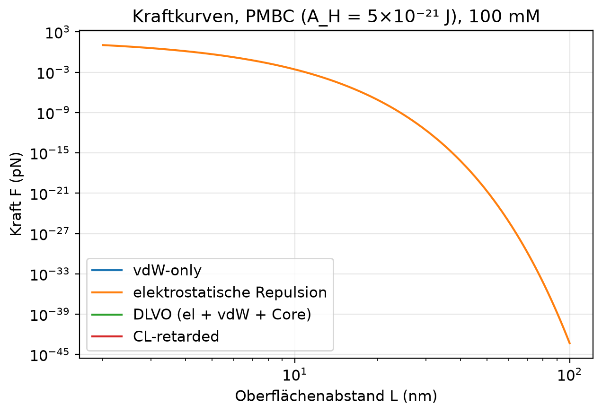

- **In plain words:** a "how hard do I push or pull at this distance?" card for each force recipe, for the stickier material (PMBC).
- **What it shows:** force in pN versus surface gap in nm on logarithmic axes for PMBC at $A_H=5\times10^{-21}\ \mathrm{J}$ and 100 mM salt.
- **How to read it:** the visible positive branch shows the extremely rapid decay of electrostatic repulsion with gap. Equal horizontal distance is not equal force change: both axes span orders of magnitude.
- **Critical plotting caveat:** the notebook passes **signed** forces to Matplotlib's `loglog`. Negative values cannot appear on a standard logarithmic axis. Attractive vdW and CL curves, and DLVO regions where the net force is attractive, are therefore omitted rather than drawn as zero. Use the equations and Figure 2 for the attractive signs and energy scales; do not interpret an invisible curve as zero force.

#### Figure 2 — Interaction potentials normalized by thermal energy

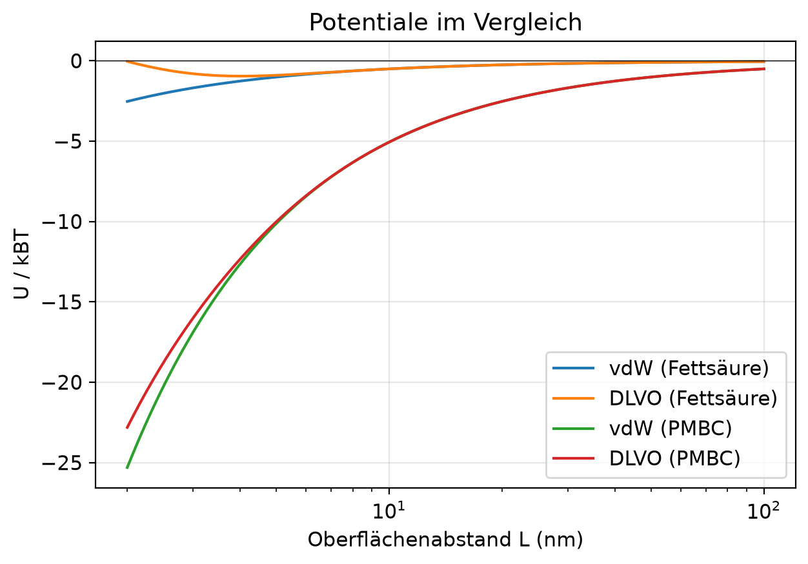

- **In plain words:** how deep the energy valley is at each gap — valleys are where a pair prefers to sit, and a deeper valley means a stickier pair.
- **What it shows:** $U/k_BT$ on a linear vertical axis versus logarithmic surface gap for fatty acid and PMBC, comparing vdW with DLVO.
- **How to read it:** negative values indicate attractive potential energy; the horizontal zero line is the reference. PMBC has the tenfold larger Hamaker constant and therefore the much deeper vdW well. At larger gaps, electrostatic and core contributions decay, so each DLVO curve approaches its corresponding vdW curve.
- **Interpretation:** for fatty acid, electrostatic repulsion substantially offsets the weaker attraction near contact, producing a much shallower DLVO well. For PMBC, the attractive well is many $k_BT$ deep at the smallest plotted gaps. A deep pair potential supports possible stabilization, but does not prove many-particle cluster formation or long-time memory.

#### Figure 3 — Retardation-factor parameter sweep

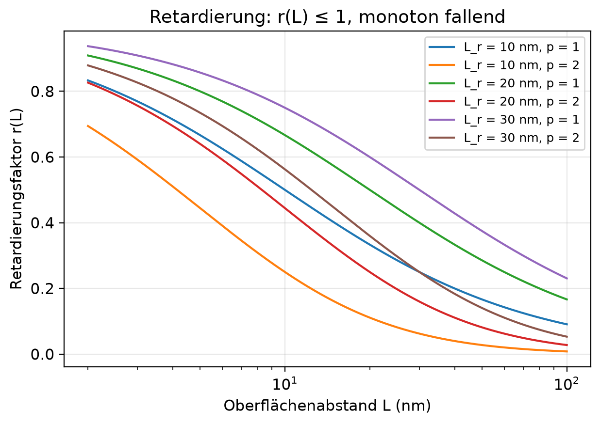

- **In plain words:** how much the fading factor weakens attraction at each distance, for a few knob settings.
- **What it shows:** $r(L)$ for $L_r=10,20,30\ \mathrm{nm}$ and $p=1,2$. The horizontal axis is logarithmic; the vertical axis is linear from zero toward one.
- **How to read it:** every curve decreases monotonically. For the same $L_r$, $p=2$ suppresses the factor more rapidly than $p=1$; for the same $p$, a larger $L_r$ preserves more of the near-field interaction to larger gaps.
- **Interpretation and caveat:** this plot verifies the intended attenuation behavior of the educational approximation. It is not a fit to experimental material response and not a substitute for a full Lifshitz/Matsubara calculation.

#### Figure 4 — DLVO versus retarded CL by material

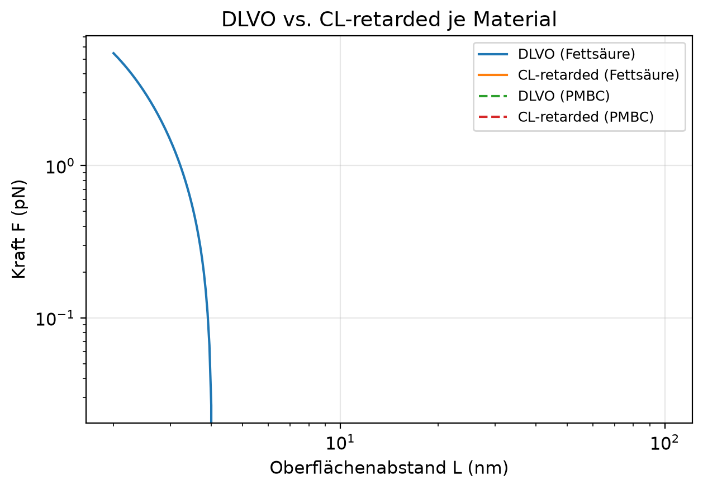

- **In plain words:** side-by-side push/pull cards for the two attraction recipes and two materials.
- **What it shows:** the intended comparison is DLVO and retarded-CL force for fatty acid and PMBC, with solid lines for fatty acid and dashed lines for PMBC.
- **How to read it:** the visible blue positive branch identifies a net-repulsive DLVO region for the weaker fatty-acid attraction. The rest of the signed curves are largely absent because the same standard log-log limitation applies.
- **Critical plotting caveat:** the absence of orange, green, or red curves does **not** mean their forces are zero. Negative CL forces and net-attractive DLVO regions cannot be rendered on this axis. This figure is useful for locating visible repulsive behavior, not for visually ranking attractive force magnitudes.

### Team 1: Pair and cluster dynamics

#### Figure 5 — Example pair trajectories

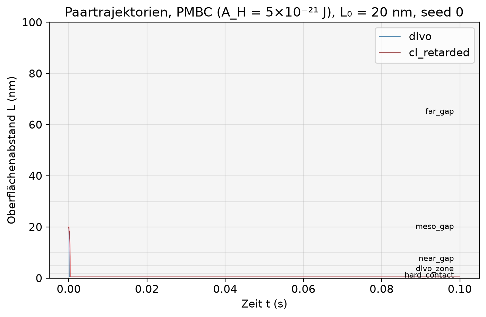

- **In plain words:** watch one pair approach over time — do the balls snap together, hover, or drift apart?
- **What it shows:** PMBC pair gap versus time for DLVO and retarded CL, starting at $L_0=20\ \mathrm{nm}$ with seed 0. Gray bands label the distance zones.
- **How to read it:** both trajectories rapidly leave the 20 nm starting region and collapse toward the lower pair-dynamics boundary, then remain near contact for the displayed 0.1 s.
- **Interpretation and caveats:** under these settings, both model variants produce strong pair approach. This is one pair, one material, and one seed—not an ensemble result. The 1D pair clamps the gap to its allowed interval, so the plot should not be used to diagnose the deep overlaps later reconstructed from the 2D export.

#### Figure 6 — Pair dwell-time histograms

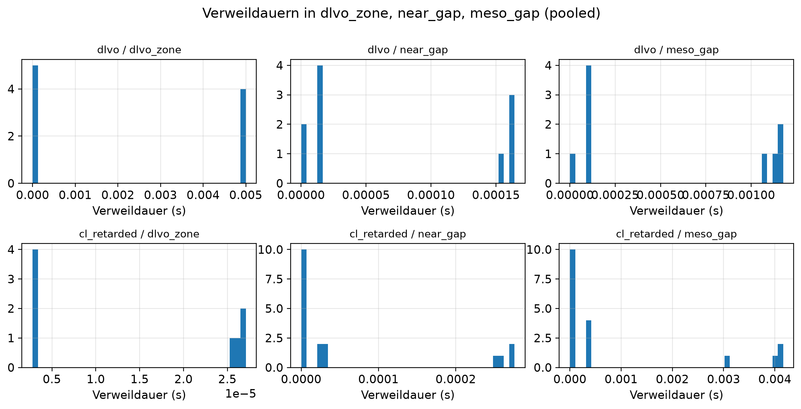

- **In plain words:** a tally of how long pairs linger in each distance zone — bars farther right mean longer visits.
- **What it shows:** pooled contiguous dwell durations in `dlvo_zone`, `near_gap`, and `meso_gap` for DLVO and retarded CL, across materials and seeds. Vertical axes count observed runs; horizontal axes show seconds.
- **How to read it:** compare shapes within each panel, not bar heights across panels without checking the different horizontal scales. Bins near zero represent short stays; mass at the far right represents long stays.
- **Critical plotting caveat:** the generating code clips displayed durations at **5 ms** before histogramming. The rightmost bin therefore accumulates longer durations and is not a precise lifetime estimate. These pair-level dwells also use a different definition and simulation setup from Team 2's macrostate dwells.

#### Figure 7 — Dilute random baseline

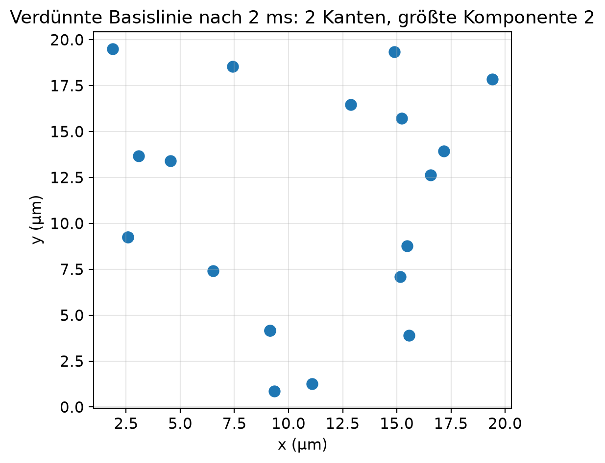

- **In plain words:** scatter 20 balls randomly in the big box and ask: do any find each other within 2 ms? (Spoiler: mostly no.)
- **What it shows:** positions of 20 initially random particles after 2 ms in the 20 µm square box. The title reports two contact edges and a largest connected component of size two.
- **How to read it:** most particles remain far outside nanometer-scale interaction range; only close pairs contribute graph edges. Marker size is a plotting choice, not a to-scale drawing of a 500 nm radius.
- **Interpretation and caveat:** this run shows no large emergent cluster under the dilute baseline conditions. It motivates preclustered starts for persistence analysis, but one short simulation cannot prove that spontaneous formation is impossible in general.

#### Figure 8 — Persistence from different preclustered gaps

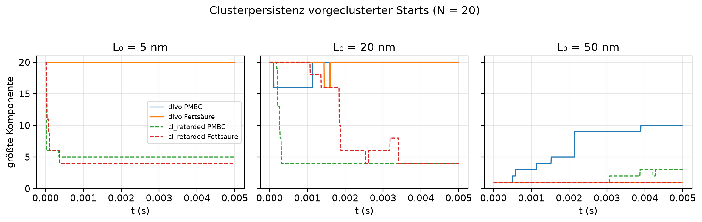

- **In plain words:** start balls at different spacings and watch whether the starting group holds together, crumbles, or reconnects.
- **What it shows:** largest connected component over 5 ms for N=20 lattices initialized at $L_0=5,20,50\ \mathrm{nm}$. Solid lines are DLVO; dashed lines are retarded CL; colors distinguish materials.
- **How to read it:** a falling curve means that the initially connected lattice breaks into smaller components; a rising curve means that separate components become connected under the 30 nm contact rule. At 5 nm, the DLVO examples remain at size 20. At 20 nm, they finish at size 20 despite transient dips, while the CL examples fragment into smaller components. At 50 nm, the initial graph is disconnected and some components later grow.
- **Interpretation and caveats:** initial gap and contact topology strongly affect the result. These are persistence/reconnection experiments from ordered starts, **not spontaneous formation from a dilute phase**. CL lacks core repulsion, so its compact components may also involve overlap artefacts.

#### Figure 9 — Full component-size distributions for different N

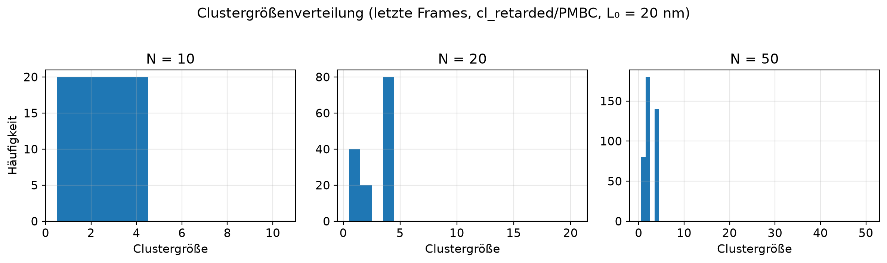

- **In plain words:** a census of group sizes at the end of each run — counting singles, pairs, threes, and bigger groups.
- **What it shows:** all connected-component sizes from the final 20 frames of retarded-CL/PMBC runs with N=10, 20, and 50 and $L_0=20\ \mathrm{nm}$.
- **How to read it:** the horizontal axis is component size and the vertical axis is component occurrence count. Every frame contributes all of its components, so these are not particle counts or normalized probabilities. The N=20 example concentrates much mass at size four; the N=50 example concentrates on small components.
- **Interpretation and caveats:** component-size distributions contain more information than the largest component alone. However, the panels are exploratory runs with different N, not a controlled convergence study, and the absence of core repulsion limits physical interpretation.

#### Figure 10 — Contact-graph snapshot and coincident particles

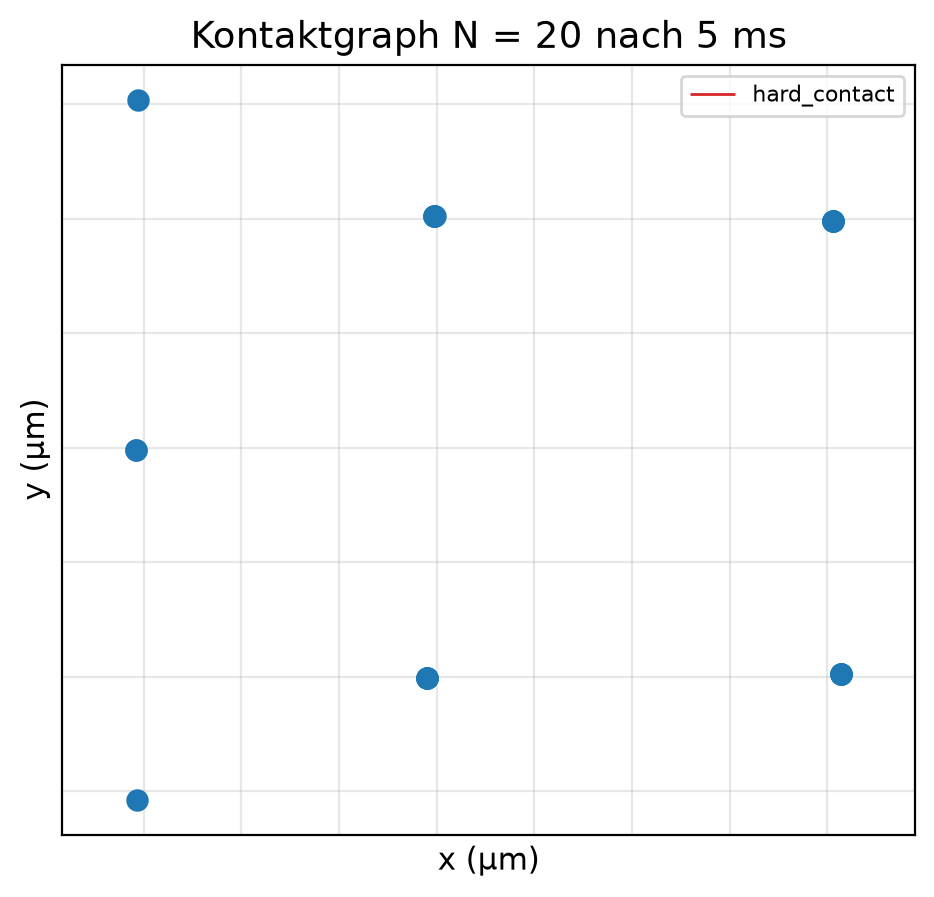

- **In plain words:** the final "who is touching whom" friendship map — dots are balls, red lines are contacts.
- **What it shows:** the final N=20 retarded-CL/PMBC contact graph after 5 ms, with nodes placed at particle coordinates and hard-contact edges intended in red.
- **How to read it:** node positions show several spatially separated groups. Fewer than 20 markers are visibly distinguishable because particles can nearly coincide; overlapping hard-contact edges can collapse to invisible line segments.
- **Critical interpretation caveat:** do not count particles or infer component sizes by counting visible dots. The underlying graph still has 20 node IDs. This snapshot makes the no-core-repulsion artefact tangible: a graph can report contact topology even when the 2D geometry is not a realistic arrangement of separate spheres.

### Team 1: Sensitivity and controls

#### Figure 11 — Hamaker constant × salt heatmap

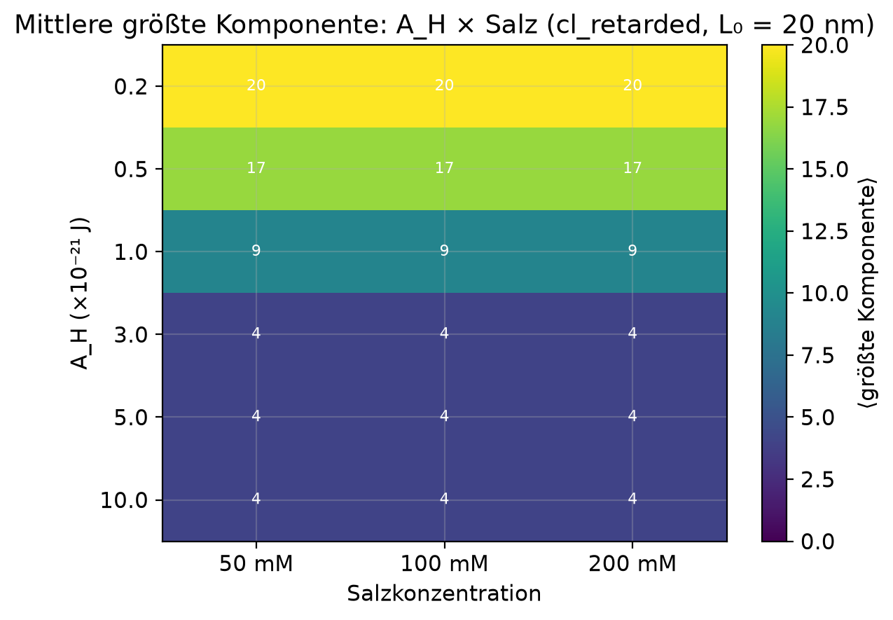

- **In plain words:** a grid of experiments asking which stickiness-and-salt combinations keep the biggest group together.
- **What it shows:** mean largest component in the last quarter of N=20 retarded-CL runs across six Hamaker constants and three salt concentrations, starting from a 20 nm lattice.
- **How to read it:** each cell is one simulation outcome; brighter yellow means a larger average component. Rows are constant across salt because `cl_retarded` contains no electrostatic term, so changing the Debye length cannot affect this model variant.
- **Interpretation and caveats:** the non-monotonic Hamaker trend is a property of these preclustered graph dynamics, not a general law that stronger attraction produces smaller clusters. Initial lattice connectivity, threshold-based components, the force cap, and deep overlaps all influence the outcome. Salt independence here must not be generalized to full DLVO or full Lifshitz physics.

#### Figure 12 — Brownian-noise sweep in the pair model

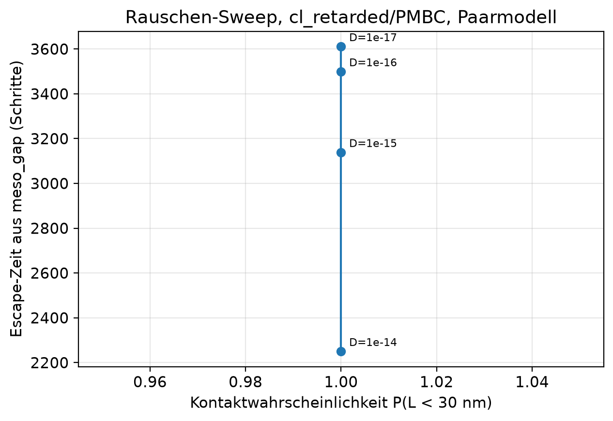

- **In plain words:** crank up the random shaking and ask whether pairs escape the starting zone faster.
- **What it shows:** mean escape time in steps from the starting `meso_gap` versus contact probability $P(L<30\ \mathrm{nm})$ for retarded-CL/PMBC at four diffusion coefficients, averaged over seeds 0, 1, and 2.
- **How to read it:** higher $D$ corresponds to stronger random kicks. The displayed escape time decreases as $D$ increases, while the contact probabilities are all 1.00 to the displayed precision.
- **Interpretation and caveats:** stronger noise can accelerate the first exit even when almost all sampled gaps remain below 30 nm. First-passage time and time-averaged contact probability measure different things. These are short pair simulations with three seeds, not a general noise-scaling law for clusters.

#### Figure 13 — Contact-definition sensitivity for one snapshot

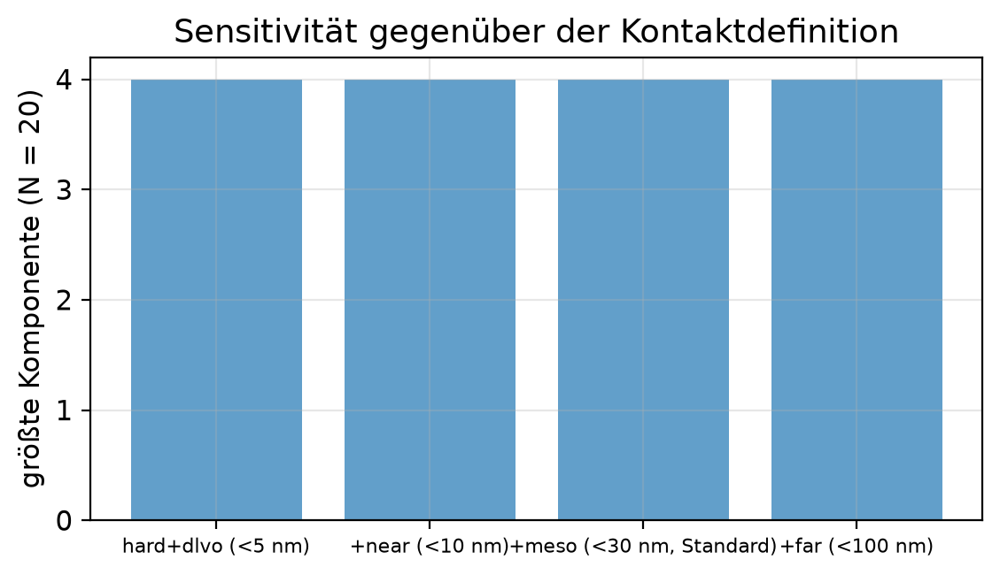

- **In plain words:** re-judge the same final snapshot with stricter and looser "touching" rules to see if the biggest group changes.
- **What it shows:** largest component for one N=20 retarded-CL/PMBC final configuration using cumulative gap cutoffs of 5, 10, 30, and 100 nm.
- **How to read it:** all four bars reach four, meaning that the largest component has the same size under all four definitions for this snapshot. This does not imply that edge counts or other components are identical.
- **Interpretation and caveat:** the selected configuration is threshold-insensitive in this one metric. It is not evidence that contact definitions never matter; Team 2's jitter and hard/near/meso comparisons provide the broader sensitivity analysis.

#### Figure 14 — Negative control with elevated diffusion

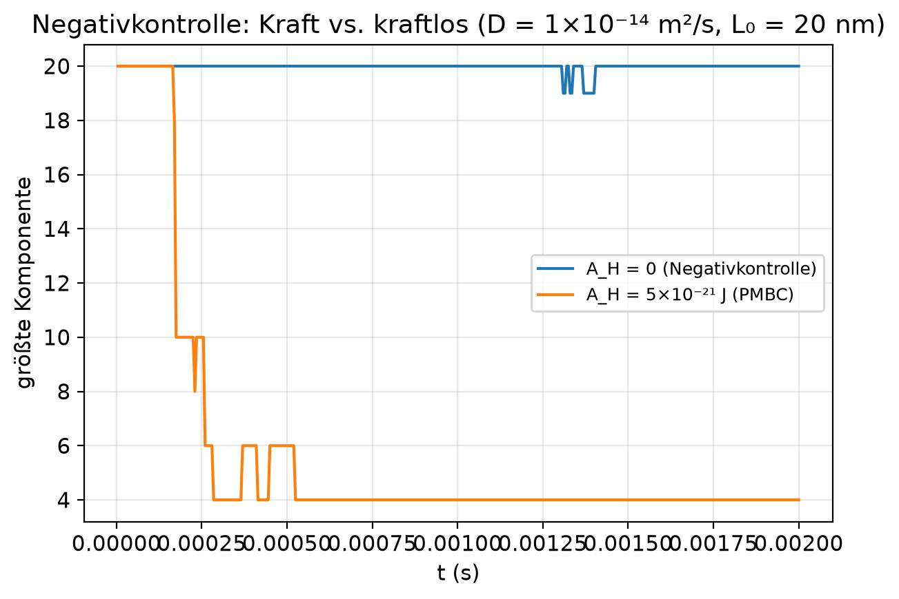

- **In plain words:** the placebo run, with forces switched off, showing what shaking alone does — so we know the measuring stick is not inventing clusters.
- **What it shows:** largest component over 2 ms for a force-free control ($A_H=0$) and a PMBC-strength retarded-CL run, both with $D=10^{-14}\ \mathrm{m^2\,s^{-1}}$, N=20, and the same preclustered start.
- **How to read it:** the force-free blue trace remains near the initial size 20, with brief drops, while the orange interacting trace breaks down to a largest component of four.
- **Interpretation and caveats:** removing the interaction changes graph persistence under this deliberately high-noise control. The control does not show cluster birth from a dilute phase, and its $D$ is 100 times the standard $10^{-16}\ \mathrm{m^2\,s^{-1}}$, so its numerical trace must not be conflated with the main export.

### Team 2: Final N=20 macrostate analysis

#### Figure 15 — Raw versus persistence-filtered labels

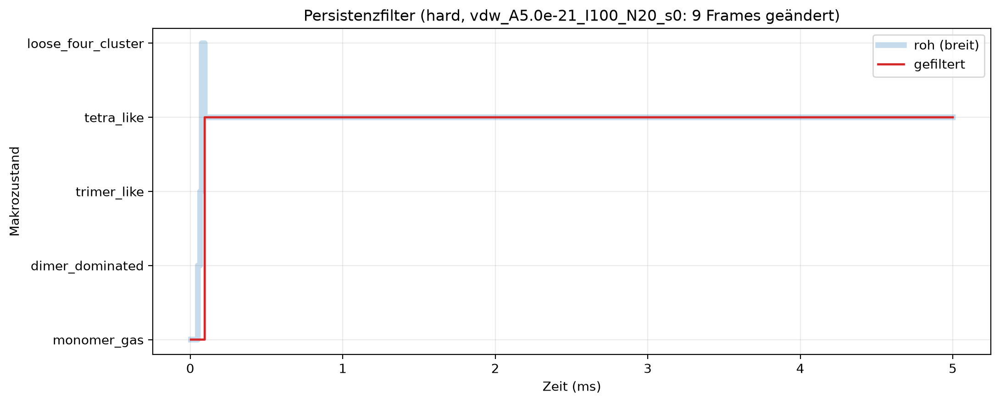

- **In plain words:** before/after of the label-smoother — which brief flickering labels did the filter erase?
- **What it shows:** the run with the most raw/filtered changes: hard-graph labels for `vdw_A5.0e-21_I100_N20_s0`. The wide pale-blue line is raw; the thin red line is filtered. Nine frames change.
- **How to read it:** brief early excursions through `monomer_gas`, `dimer_dominated`, `trimer_like`, and `loose_four_cluster` are replaced by the persistent `tetra_like` state. Horizontal overlap elsewhere means both sequences agree.
- **Interpretation and caveats:** this is a deliberately selected extreme example, not a typical meso sequence. Across the full export only **57 of 57,000** state rows change (**0.1%**), and **no N=20 meso row changes**. The filter therefore has almost no effect on the final meso conclusions; its heuristic nature still matters for noisier data.

#### Figure 16 — Distribution of the largest component by model and material

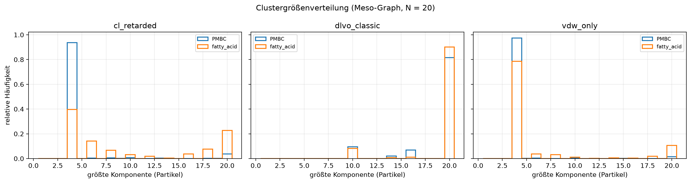

- **In plain words:** how often the biggest group in the box is size 1, 2, …, 20, for each model and material.
- **What it shows:** normalized distributions of `largest_cluster` over all frames and three seeds for each model/material block in the N=20 meso graph. Despite the broad German title, this is specifically the **largest-component** distribution, not the full component-size distribution of Figure 9.
- **How to read it:** outlined blue and orange histograms show PMBC and fatty acid. CL and vdW put substantial mass at four, whereas DLVO places most mass at 20 but also includes smaller large-cluster sizes.
- **Interpretation and caveats:** the figure supports a model/material difference in coarse-grained connectivity. Because every main run starts preclustered, size 20 is an initially available state and must not be presented as spontaneous aggregation. For vdW and CL, deep overlaps further restrict physical interpretation.

#### Figure 17 — Material comparison of filtered macrostates

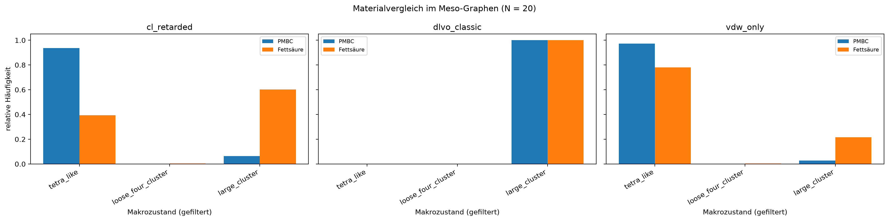

- **In plain words:** a time budget per model and material — which state label each one spends its 5 ms in.
- **What it shows:** relative filtered-state frequencies for PMBC and fatty acid in each model's N=20 meso sequences, pooled over three seeds.
- **How to read it:** within each panel, bars of one color sum to one. CL/PMBC is 93.67% `tetra_like`, while CL/fatty-acid is 60.27% `large_cluster` and 39.33% `tetra_like`. DLVO is 100% `large_cluster` for both materials. vdW/PMBC is 97.30% `tetra_like`; vdW/fatty-acid is 78.13% `tetra_like` and 21.50% `large_cluster`, with a small loose-four remainder.
- **Interpretation and caveats:** material dependence is visible in CL and vdW but not in the coarse DLVO label. Identical DLVO labels do not imply identical microscopic forces or geometry. All frequencies describe this 5 ms, preclustered ensemble.

The corresponding current CSV summaries are:

| Model | Material | State | Frequency | Mean dwell (frames) |
|---|---|---|---:|---:|
| `cl_retarded` | PMBC | `tetra_like` | 0.9367 | 936.7 |
| `cl_retarded` | PMBC | `large_cluster` | 0.0633 | 63.3 |
| `cl_retarded` | fatty acid | `large_cluster` | 0.6027 | 361.6 |
| `cl_retarded` | fatty acid | `tetra_like` | 0.3933 | 236.0 |
| `dlvo_classic` | either | `large_cluster` | 1.0000 | 1000.0 |
| `vdw_only` | PMBC | `tetra_like` | 0.9730 | 973.0 |
| `vdw_only` | PMBC | `large_cluster` | 0.0270 | 27.0 |
| `vdw_only` | fatty acid | `tetra_like` | 0.7813 | 468.8 |
| `vdw_only` | fatty acid | `large_cluster` | 0.2150 | 129.0 |

**Overlap warning for all vdW/CL interpretations:** in the current non-separated N=20 pair rows, the pooled fraction with extreme overlap $L<-900\ \mathrm{nm}$ is 91.8% for vdW/PMBC, 72.1% for vdW/fatty-acid, 87.2% for CL/PMBC, and 33.8% for CL/fatty-acid. Both DLVO groups have 0.0%. Each fraction uses all N=20 rows for that model/material group in `pair_zones.csv` as its denominator. Consequently, vdW/CL `tetra_like` and `large_cluster` labels can describe classes containing nearly coincident particles, not realistic separated-sphere geometries.

#### Figure 18 — Dwell-time distributions

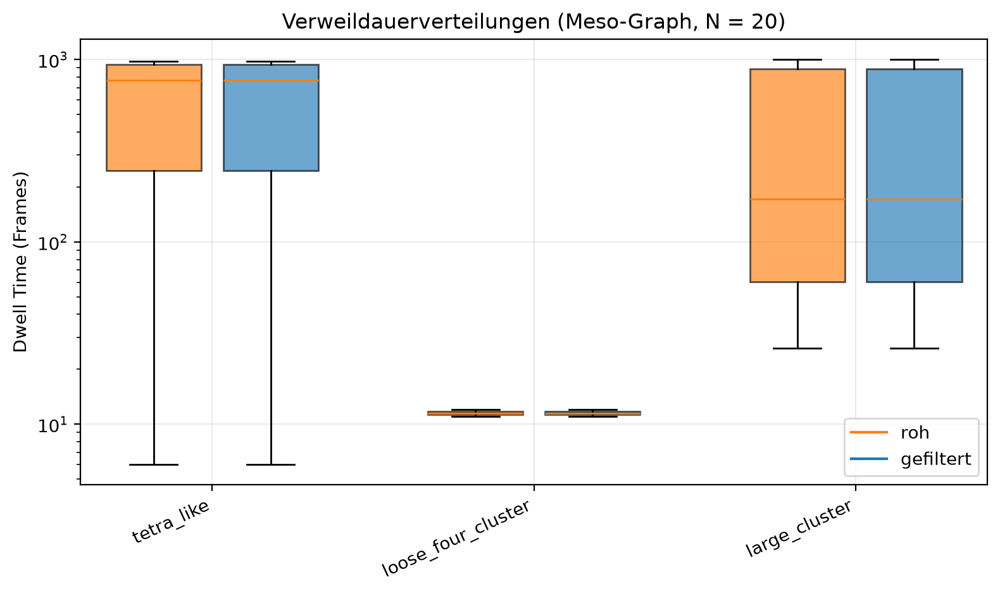

- **In plain words:** once the system enters a state, how long does it stay? Each box compares one state's staying power.
- **What it shows:** raw and filtered dwell-run distributions for the three observed N=20 meso states on a logarithmic vertical axis. Boxes show central spread, lines show medians, and whiskers show the displayed range with outliers hidden.
- **How to read it:** `tetra_like` and `large_cluster` include runs approaching the full 1,000-frame window, while `loose_four_cluster` runs are around an order of magnitude shorter. Raw and filtered boxes coincide because no meso labels change under the filter.
- **Interpretation and caveats:** dominant states are persistent within the observation window, while the loose-four label is transitional. Runs touching sequence boundaries are censored, and a 1,000-frame dwell does not prove that a state would persist beyond 5 ms.

#### Figure 19 — Filtered transition matrices

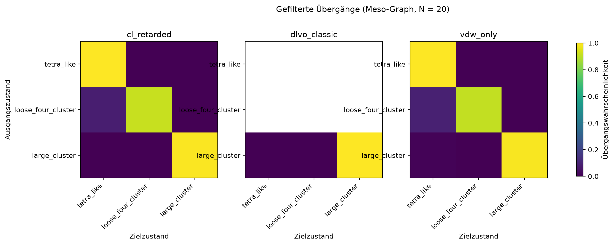

- **In plain words:** a "where next?" grid — rows are the current label, columns are the next label, brighter means more likely.
- **What it shows:** row-normalized filtered transitions for each model, pooled over both materials and three seeds in the N=20 meso graph. Rows are source states and columns are targets.
- **How to read it:** yellow is probability one, dark purple is near zero, and blank/white rows have no outgoing transitions to normalize. Strong diagonal blocks mean that frame-to-frame self-transitions dominate. Small off-diagonal probabilities can be visually hard to distinguish after long persistent runs dominate the counts.
- **Interpretation and caveats:** the matrices support short-horizon label persistence. Pooling materials can hide subgroup differences, and self-transition probability is not return-after-departure probability. DLVO's observed `large_cluster` row is diagonal, while states without outgoing observations are unavailable rather than zero-probability rows.

#### Figure 20 — Return probability after departure

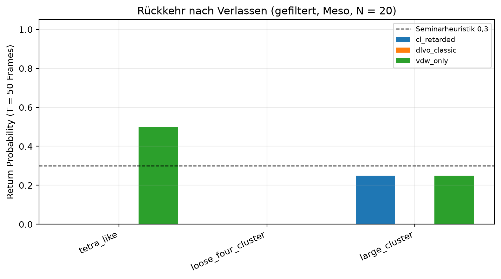

- **In plain words:** when the system leaves a state, how likely is it to come back soon? The dashed line is the pass mark.
- **What it shows:** filtered meso return probability within 50 frames, pooled by **model and state across both materials**. Returns and eligible departures are summed before dividing. The dashed line is the heuristic threshold 0.3.
- **How to read it:** vdW `tetra_like` has pooled return probability 0.50. CL and vdW `large_cluster` each have 0.25 when both materials are pooled. Zero-height measured bars and missing/unavailable values must be distinguished in the CSV.
- **Interpretation and caveats:** this pooled figure is not the candidate table. In the fatty-acid subgroup, CL `large_cluster` and vdW `large_cluster` each have 0.40 and therefore pass that criterion, while vdW `tetra_like` has 0.50. **DLVO has zero eligible departures from its dominant state, so its return value is unavailable—not zero.** Few eligible events and the 5 ms window make these probabilities coarse estimates.

The four rows passing all five heuristics in `attractor_candidates.csv` are:

| Model | Material | Graph | State | Frequency | Mean dwell | Return probability |
|---|---|---|---|---:|---:|---:|
| `cl_retarded` | fatty acid | meso | `large_cluster` | 0.6027 | 361.6 frames | 0.40 |
| `vdw_only` | fatty acid | meso | `tetra_like` | 0.7813 | 468.8 frames | 0.50 |
| `vdw_only` | fatty acid | meso | `large_cluster` | 0.2150 | 129.0 frames | 0.40 |
| `vdw_only` | fatty acid | near | `dimer_dominated` | 0.0983 | 49.2 frames | 0.50 |

All four belong to models affected by the deep-overlap limitation. They are reproducible, persistent, return-prone **labels under this model and rule set**, not formal attractor proofs or evidence of physically realistic non-overlapping clusters.

#### Figure 21 — Robustness to 1 nm position jitter

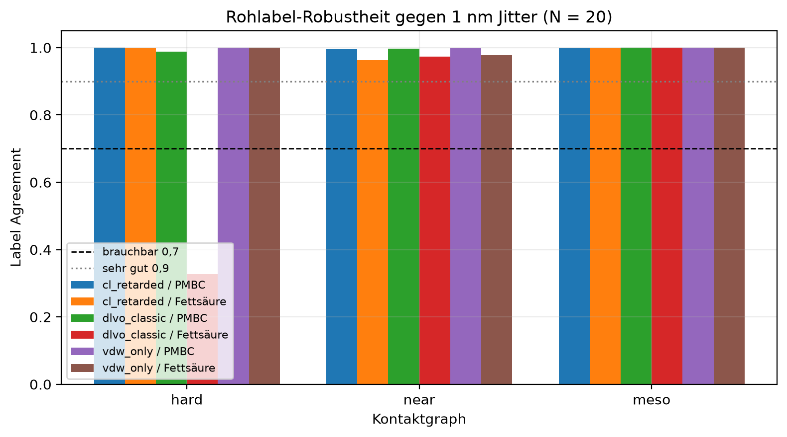

- **In plain words:** nudge every ball by 1 nm and ask: do the state labels survive the wiggle?
- **What it shows:** mean raw-label agreement for six model/material groups and three graph definitions after deterministic 1 nm Gaussian position jitter. The dashed and dotted guides mark 0.7 and 0.9.
- **How to read it:** higher bars mean more frames retain the same macrostate. Meso agreement ranges from 0.9977 to 1.0000 across the six groups. Near agreement is also high, although CL/fatty-acid is lower at 0.9633. The hard graph exposes threshold sensitivity most strongly: DLVO/fatty-acid falls to 0.3280.
- **Interpretation and caveats:** meso labels are robust to this particular small perturbation, making the meso sequence a reasonable Team-3 handoff. The hard-graph result reflects many pairs near the 2 nm boundary; it demonstrates classification sensitivity, not necessarily unstable microscopic physics. Robustness to 1 nm jitter does not establish robustness to larger perturbations, different initial conditions, or longer times.

---

## Data and Reproduction

### Quick start with the existing environment

The project uses Python 3.12 and the same small scientific stack for both teams: NumPy, pandas, Matplotlib, NetworkX, Jupyter/nbconvert, and pytest. To recreate the Team-1 environment:

```bash
cd team1_forces
python3.12 -m venv .venv
.venv/bin/pip install -r requirements.txt
```

Team 2 can use that environment directly; no second environment is required. Its `requirements.txt` documents the same stack if an independent environment is desired.

### Run the tests

From the repository root:

```bash
(cd team1_forces && .venv/bin/python -m pytest)
(cd team2_macrostates && ../team1_forces/.venv/bin/python -m pytest)
```

The current suites contain 40 Team-1 tests and 72 Team-2 tests. They cover physics consistency, exact zone boundaries, graph and macrostate rules, filtering, censored return statistics, deterministic jitter, plotting, exports, and final deliverable schemas.

### Regenerate Team-1 data and figures

Run from `team1_forces/` so notebook-relative imports and paths resolve correctly:

```bash
cd team1_forces
.venv/bin/jupyter nbconvert --to notebook --execute --inplace \
    --ExecutePreprocessor.timeout=1800 notebooks/01_force_curves.ipynb
.venv/bin/jupyter nbconvert --to notebook --execute --inplace \
    --ExecutePreprocessor.timeout=1800 notebooks/02_pair_dynamics.ipynb
.venv/bin/jupyter nbconvert --to notebook --execute --inplace \
    --ExecutePreprocessor.timeout=1800 notebooks/03_cluster_simulation.ipynb
.venv/bin/jupyter nbconvert --to notebook --execute --inplace \
    --ExecutePreprocessor.timeout=1800 notebooks/04_parameter_sweep.ipynb
```

Notebook 03 regenerates the complete four-file Team-2 input export and removes stale versions of those export files first. Its final matrix writes the 18 fair N=20 runs plus the separate N=50 run. Rerunning notebooks is a computational analysis step, not necessary for reading the supplied figures and CSVs.

For interactive exploration, use `.venv/bin/jupyter lab notebooks/` from `team1_forces/`.

### Regenerate Team-2 outputs in order

From `team2_macrostates/`:

```bash
cd team2_macrostates
../team1_forces/.venv/bin/jupyter nbconvert --to notebook --execute --inplace \
    --ExecutePreprocessor.timeout=3600 notebooks/01_zones_graphs.ipynb
../team1_forces/.venv/bin/jupyter nbconvert --to notebook --execute --inplace \
    --ExecutePreprocessor.timeout=3600 notebooks/02_sequences_attractors.ipynb
../team1_forces/.venv/bin/jupyter nbconvert --to notebook --execute --inplace \
    --ExecutePreprocessor.timeout=3600 notebooks/03_robustness_comparison.ipynb
```

The order matters: notebook 01 computes zones, pairs, graphs, features, and sequences; notebook 02 computes sequence dynamics and candidates; notebook 03 computes robustness and final comparisons. The last recorded full execution took approximately 4 minutes 20 seconds, but runtime depends on the machine.

### Units and input contract

| Quantity | Convention |
|---|---|
| Positions `x`, `y`, internal lengths | meters |
| `L_nm`, `R_nm` | nanometers in the named columns |
| Time `t` or `time` | seconds |
| Force | pN in analysis outputs |
| Energy | $U/k_BT$ in analysis outputs |
| Hamaker constant `A_H` | joules |
| Mobility | $\mathrm{m\,N^{-1}\,s^{-1}}$ |
| Diffusion and exported `noise` | $\mathrm{m^2\,s^{-1}}$; `noise` carries $D$ |
| Periodic box | fixed at 20 µm; not inferred from observed coordinates |
| Sign | negative radial force = attraction; positive = repulsion |

Team 2 validates required columns, finite values, unique frame/particle rows, consistent particle sets, and one model/material parameter set per run. Particle IDs are preserved rather than replaced with assumed contiguous indices.

### Team-1 CSV contracts

All files are in `team1_forces/data/processed/`.

| File | Exact columns | Contents |
|---|---|---|
| `positions.csv` | `run_id, seed, t, particle_id, x, y, model_type, A_H, lambda_D, noise, T` | One row per particle and recorded frame |
| `pairs.csv` | `run_id, seed, t, i, j, L_nm, contact_zone, force_mode` | Non-separated pairs ($L<100$ nm) |
| `cluster_metrics.csv` | `run_id, seed, t, largest_cluster, mean_degree, n_edges, n_components` | Frame-level Team-1 graph summaries |
| `parameters.csv` | `run_id, model_type, R_nm, A_H, salt_mM, L_ret_nm, p_ret, dt, mobility, diffusion` | One parameter row per run |

Separated pairs can be reconstructed from positions and the periodic box. Run IDs deterministically encode model and important parameter values, including particle count and seed for the final export.

### Team-2 CSV contracts

All files are in `team2_macrostates/data/processed/`.

| File | Purpose |
|---|---|
| `pair_zones.csv` | Every non-separated pair with periodic surface gap and exact zone |
| `graph_features.csv` | Hard/near/meso features per frame, including full sorted component sizes |
| `macrostate_sequences.csv` | Raw and filtered labels per frame and graph with metadata |
| `dwell_times.csv` | Contiguous runs, durations, and left/right censoring flags |
| `sequence_metrics.csv` | Per-run frequencies, dwell, self-transitions, returns, agreement, and seed counts |
| `transition_matrices.csv` | Long-format source/target counts and row-normalized probabilities |
| `attractor_candidates.csv` | Aggregated metrics, five individual heuristic flags, and overall candidate flag |
| `label_robustness.csv` | Raw versus jittered labels for every frame and graph |
| `team3_macrostates.csv` | Meso-only downstream handoff |

<details>
<summary>Full Team-2 column schemas</summary>

- `pair_zones.csv`: `run_id, seed, time, i, j, L_m, L_nm, zone, model_type, material_type`
- `graph_features.csv`: `run_id, seed, time, graph_type, model_type, material_type, A_H, salt_mM, noise, temperature, R_nm, largest_cluster, number_of_components, number_of_edges, mean_degree, cluster_size_distribution, n_particles`
- `macrostate_sequences.csv`: `run_id, seed, time, graph_type, macrostate_raw, macrostate_filtered, model_type, material_type, A_H, salt_mM, noise, temperature, R_nm, largest_cluster, mean_degree, number_of_edges, number_of_components, n_particles`
- `dwell_times.csv`: `state, start_index, end_index, start_time, end_time, dwell_steps, dwell_seconds, left_censored, right_censored, run_id, seed, model_type, material_type, n_particles, graph_type, sequence_type`
- `sequence_metrics.csv`: `run_id, seed, model_type, material_type, n_particles, graph_type, sequence_type, state, n_frames, frequency, mean_dwell_steps, mean_dwell_seconds, self_transition_probability, return_probability_T50, return_eligible_T50, returns_T50, mean_return_steps_T200, mean_return_seconds_T200, return_eligible_T200, returns_T200, label_agreement, seed_count_in_state, total_seeds`
- `transition_matrices.csv`: `n_particles, model_type, material_type, graph_type, sequence_type, source, target, count, probability`
- `attractor_candidates.csv`: `n_particles, model_type, material_type, graph_type, state, frequency, mean_dwell_steps, return_probability_T50, mean_return_steps_T200, seed_count, total_seeds, label_agreement, frequency_ok, mean_dwell_ok, return_probability_ok, seed_reproducibility, label_agreement_ok, candidate`
- `label_robustness.csv`: `run_id, seed, time, model_type, material_type, n_particles, graph_type, sigma_nm, raw_macrostate, jitter_macrostate, label_agreement`
- `team3_macrostates.csv`: `run_id, seed, time, macrostate_raw, macrostate_filtered, model_type, material_type, A_H, salt_mM, noise, largest_cluster, mean_degree`

</details>

### Team-3 handoff

`team2_macrostates/data/processed/team3_macrostates.csv` contains **19,000 rows**: 19 runs × 1,000 frames, using only the meso graph. Its exact schema is:

```text
run_id, seed, time, macrostate_raw, macrostate_filtered,
model_type, material_type, A_H, salt_mM, noise,
largest_cluster, mean_degree
```

Downstream analysis should normally use `macrostate_filtered`, while retaining `macrostate_raw` for filter diagnostics and sensitivity checks. The handoff contains sequences and graph metadata only; Team-3 information/entropy analysis is not implemented in this repository.

### Detailed companion documentation

- [Team 1 technical README](team1_forces/README.md)
- [Team 1 German report skeleton](team1_forces/report/report.md)
- [Team 2 technical README](team2_macrostates/README.md)
- [Team 2 final German report](team2_macrostates/report/report.md)
- [Team 1 design record](docs/superpowers/specs/2026-11-04-team1-protocell-forces-design.md)
- [Team 2 design record](docs/superpowers/specs/2026-11-10-team2-macrostates-design.md)

The companion reports contain German prose and additional methodological context. Where this English overview reports regenerated numerical values, the current processed CSVs are the direct source.

---

## Limitations

These are boundaries on interpretation, not minor footnotes:

1. **No spontaneous-formation claim.** The main export starts from preclustered lattices. It measures persistence, fragmentation, reconnection, and return—not formation from an initially dilute random phase.
2. **Deep overlap in vdW and CL.** Without core repulsion, particles can nearly coincide. A large fraction of their non-separated pair rows has $L<-900$ nm, so graph-based compact states must not be interpreted as realistic non-overlapping sphere assemblies.
3. **Simplified CL physics.** The multiplicative retardation factor is educational. There is no full dielectric-response, Matsubara-mode, TE/TM, or shell-model calculation, and no invented `cl_meso_hypothesis` force.
4. **Didactic dynamics.** The diffusion coefficient is chosen for the assignment; the 20 pN force cap and $10^{-7}$ s time step prioritize stability. Two-dimensional motion omits hydrodynamics, explicit membrane chemistry, many-body screening, and three-dimensional geometry.
5. **Short finite window.** The main trajectories span 5 ms. Boundary runs are censored, and long-time persistence or return behavior cannot be inferred beyond the observed horizon.
6. **Sparse statistics.** Three seeds are a minimum reproducibility check, not high-precision sampling. Some return estimates contain few eligible departures; DLVO's dominant state has none, so return statistics are unavailable rather than zero.
7. **Limited parameter coverage.** The fair comparison fixes N=20, 100 mM salt, and one preclustered initial gap. The N=50 run and Team-1 sweeps are separate explorations, not pooled replicates.
8. **Rule-based coarse-graining.** Macrostates depend on graph thresholds and largest-component rules. `tetra_like` is a 2D compactness proxy, and `far_gap` is proximity rather than proof of binding.
9. **Heuristic filtering and candidate selection.** Five-frame persistence and five attractor criteria are seminar heuristics. Raw labels remain available, and candidate status is not a formal attractor proof.
10. **Signed-force plotting limitation.** Standard log-log axes omit negative attractive branches in Team-1 Figures 1 and 4. Missing lines are a visualization limitation, not zero forces.
11. **Scope ends at the handoff.** No Team-3 analysis, experimental validation, or quantitative comparison with measured protocell populations is included.

---

## Glossary and References

### Glossary

| Term | Meaning in this project |
|---|---|
| **Protocell** | A simplified spherical prebiotic-cell model with radius 500 nm |
| **Surface gap $L$** | Center distance minus two radii; negative values indicate overlap |
| **Hamaker constant $A_H$** | Material/solvent parameter setting vdW interaction strength |
| **DLVO** | Screened electrostatic repulsion plus vdW attraction; this implementation also adds core repulsion |
| **Casimir–Lifshitz (CL)** | Fluctuation-induced electromagnetic interaction framework; simulated here only through a retarded vdW approximation |
| **Retardation** | Distance-dependent weakening represented by $r(L)\le1$ |
| **Debye length** | Exponential screening length of the electrostatic term in electrolyte |
| **Brownian dynamics** | Deterministic force drift plus Gaussian thermal noise |
| **Minimum image** | Shortest displacement between particles in a periodic box |
| **Seed** | Recorded random-generator input used to reproduce a stochastic trajectory |
| **Contact graph** | Nodes are particles; edges connect pairs within a selected gap range |
| **Connected component** | Set of nodes reachable from one another through graph edges |
| **Cluster** | Used here as shorthand for a connected component, not a separately measured chemical object |
| **Macrostate** | Rule-based label summarizing a graph configuration |
| **Coarse-graining** | Replacing detailed microscopic coordinates with a lower-dimensional label |
| **Dwell time** | Duration of one uninterrupted stay in a zone or macrostate |
| **Self-transition** | Remaining in the same macrostate between consecutive frames |
| **Return probability** | Fraction of eligible departures followed by a return within a specified horizon |
| **Censoring** | Incomplete duration/return information at the finite observation boundary |
| **Jitter** | Small deterministic-seed Gaussian position perturbation used to test labels |
| **Label agreement** | Fraction of frames whose raw macrostate is unchanged after jitter |
| **Attractor candidate** | State passing all five seminar heuristics; not a formally proven attractor |

### Literature pointers

- J. N. Israelachvili, *Intermolecular and Surface Forces* — van der Waals, DLVO, hydration, and surface-force foundations.
- H. B. G. Casimir and E. M. Lifshitz — foundational work on fluctuation-induced forces and their generalization to dielectric bodies.
- Derjaguin–Landau and Verwey–Overbeek — the classical DLVO framework.
- Nunes et al. and Spreng et al. — Casimir interactions between spheres in electrolytes, as listed in the assignment bibliography.
- Schoger et al. — universal Casimir interactions of dielectric spheres in salt water, as listed in the assignment bibliography.
- Seyedzahedi and Moradian — electrolytes, layered media, TE/TM modes, and Hamaker coefficients, as listed in the assignment bibliography.

For implementation details and the exact seminar context, use the companion project documents linked above rather than treating this README as a replacement for the primary literature.
