# Team 1 – Physikalisches Basismodell: DLVO, van der Waals und Casimir–Lifshitz
## Berichtsentwurf (Stand: Projektabschluss der Implementierung)

> Hinweis: dieser Text ist ein Skeleton mit vorformulierter Physik. Stellen mit
> `[hier eigene Prosa ergänzen]` sind bewusst offen für die eigene Ausarbeitung
> und Präsentation (Woche 8). Alle Aussagen folgen der strengen
> Interpretationsregel von §10 des Aufgabenblatts.

## 1. Einleitung

Alle späteren Seminar-Teams hängen davon ab, ob die mikroskopische Dynamik sauber,
reproduzierbar und physikalisch plausibel modelliert wird. Team 1 liefert das
transparente, schrittweise verfeinerbare Basismodell der effektiven
Wechselwirkungen präbiotischer Protozellen (R = 500 nm, L = 2–100 nm) und
bereitetrobuste Mikrodaten für Team 2 auf.

[hier eigene Prosa ergänzen: Rolle von Team 1 im Seminar, eigene Schwerpunkte]

## 2. Modelle

### 2.1 Nicht-retardierte van-der-Waals-Anziehung (Modellstufe 1)

U_vdW(L) = −A_H·R_eff/(6L), F_vdW(L) = −A_H·R_eff/(6L²), R_eff = R/2
(Derjaguin/PFA). Kraft negativ = anziehend. Diese Form ist der Nahbereichsgrenzfall
der Lifshitz-Theorie.

### 2.2 Klassisches DLVO (Modellstufe 2)

U_DLVO = U_el + U_vdw + U_core mit U_el = B·e^(−κL), U_core = C·(L_core/L)^12.
Debye-Abschirmung: λ_D = 1.36 / 0.96 / 0.68 nm bei 50 / 100 / 200 mM.

### 2.3 Retardierte CL-Approximation (Modellstufe 3)

F_CL,ret(L) = F_vdW(L)·r(L), r(L) = 1/(1 + L/L_r)^p (Standard L_r = 20 nm, p = 2;
Sweep L_r = 10/20/30 nm, p = 1/2). Retardierung schwächt die Anziehung typischerweise ab.

### 2.4 Lifshitz-Ausblick (Modellstufe 4, nur Dokumentation)

F_CL(L) = F₀,long(L,κ) + F₀,TM(L) + F_n≥1^TE/TM(L): n=0-longitudinal Debye-gescreent;
höhere Matsubara-Moden in Salzlösungen weniger direkt betroffen; TE/TM getrennt;
Schalenmodell. Keine Numerik in diesem Projekt.

### 2.5 Abgrenzung

vdW und CL werden **nie addiert** (§3, §18 Fehler 1): CL-retarded *ersetzt* die
nicht-retardierte vdW-Grenze. Ein eventuell zusätzlicher mesoskopischer CL-Term
wäre explizit als Hypothese zu deklarieren; hier nicht verwendet.

## 3. Methoden

- Einheiten: SI intern; Kräfte in pN, Energien in U/kBT in allen Ausgaben; L in nm.
- Gitter: logarithmisch 2–100 nm plus Stützstellen 2, 3, 5, 10, 20, 30, 50, 100 nm.
- Brownian Dynamics (Euler–Maruyama): Drift μ·F·dt, Rauschen √(2·D·dt)·N(0,1);
  D = 1×10⁻¹⁶ m²/s, μ = 1×10⁸ m/(N·s) (Anhang).
- **Stabilität (§18 Fehler 6):** dt = 1×10⁻⁷ s, Kraftbegrenzung 20 pN
  (μ·F_max·dt ≤ 0.2 nm pro Schritt). Die Anhangs-Defaults (dt = 1×10⁻⁴ s)
  explodieren bei kleinen L – Messwerte dazu in Abschnitt 7.
- Startbedingungen Cluster: verdünnte Basislinie (Zufall, 20 µm Box) und
  vorgeclusterte Gitterstarts (L₀ ∈ {5, 20, 50} nm).
- Seeds konstant. Die Team-2-Übergabe nutzt {0, 1, 42} je N=20-Block,
  Run-IDs deterministisch; der klassische Referenzexport bleibt Seed 42.
- Metriken (§11): Kraftstärke, Potentialtiefe, Kontaktwahrscheinlichkeit,
  Dwell, Escape (First-Passage aus der Startzone), Return Probability,
  Largest Component, Mean Degree.

## 4. Ergebnisse

### 4.1 Kraft- und Potentialkurven

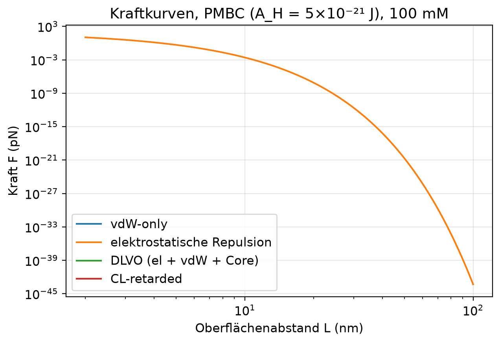

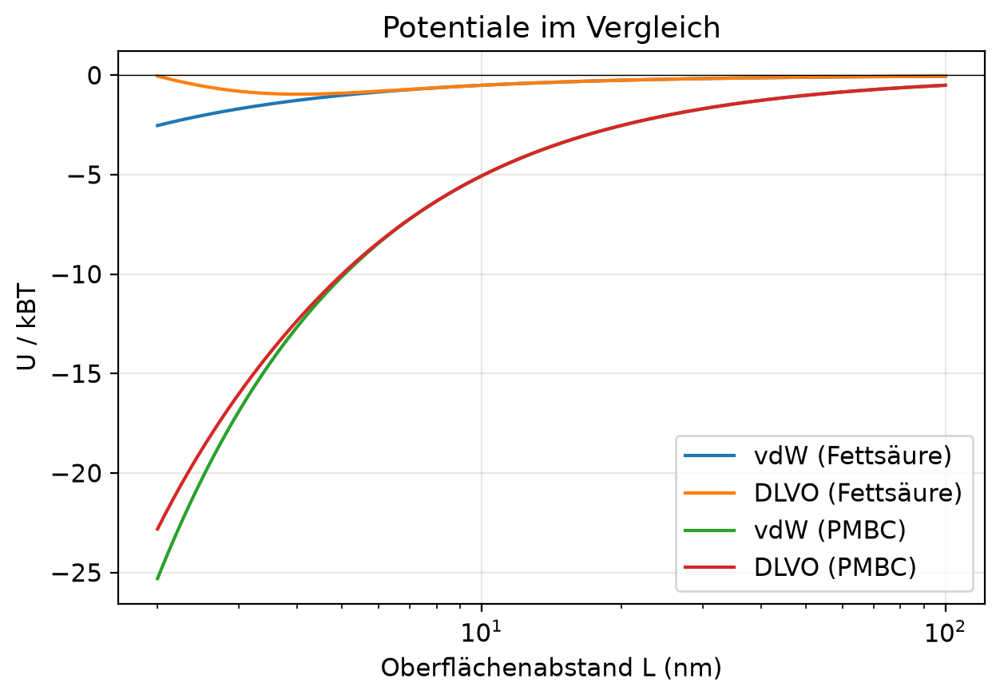

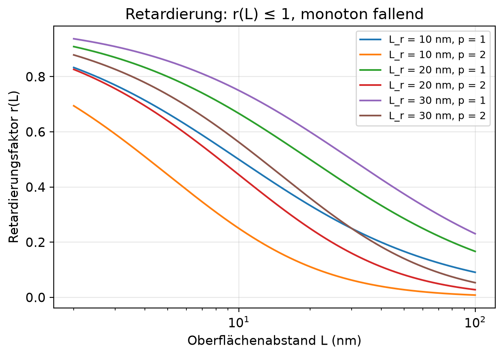

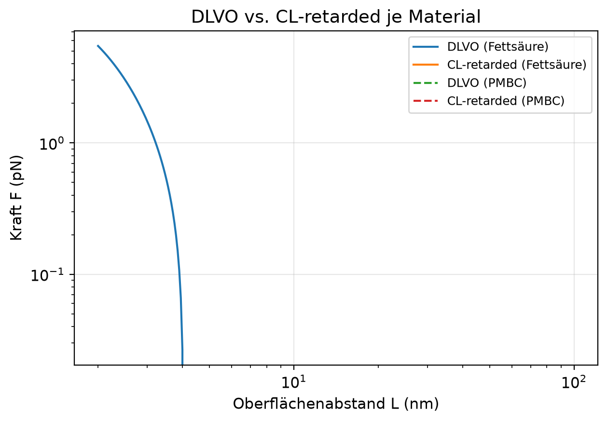

Elektrostatik verschwindet nach wenigen Debye-Längen (~2–5 nm je Salz);
Retardierung schwächt die Anziehung ab (r ≤ 1, monoton fallend).

[hier eigene Prosa ergänzen: Zahlenwerte aus den Tabellen in Notebook 01]

### 4.2 Paardynamik

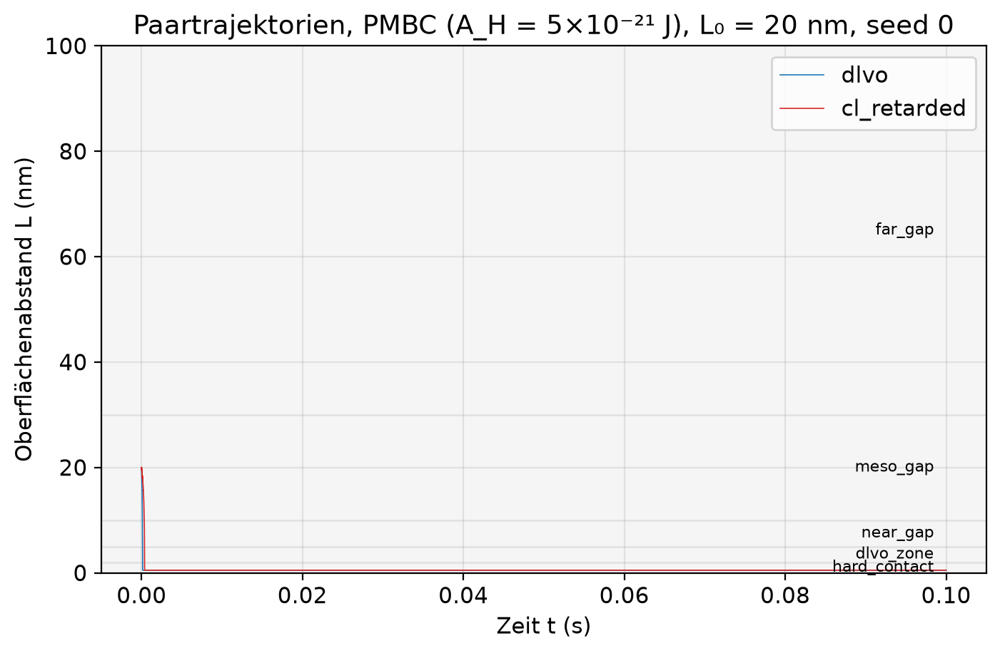

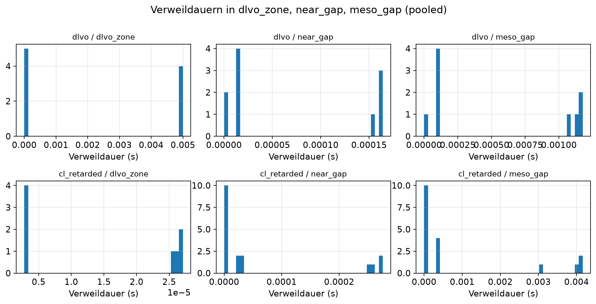

[hier eigene Prosa ergänzen: Escape-/Return-Werte aus Notebook 02]

### 4.3 Cluster-Simulation

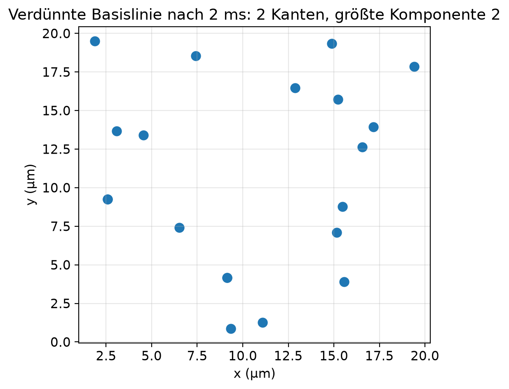

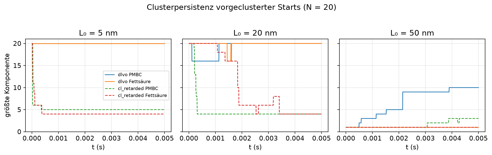

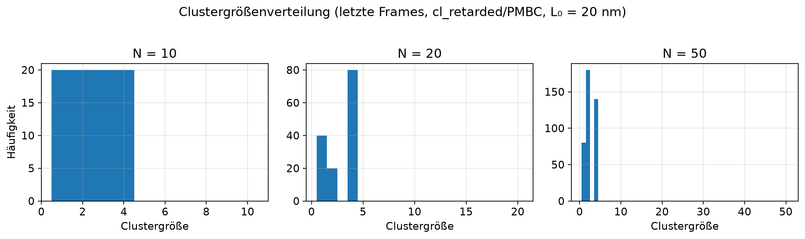

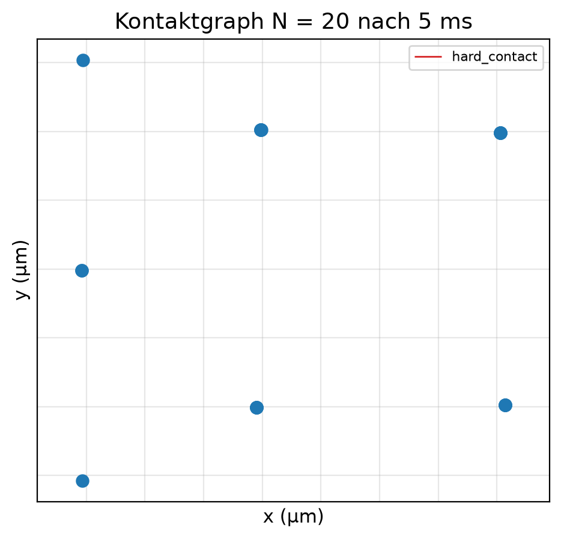

### 4.4 Sensitivität und Negativkontrolle

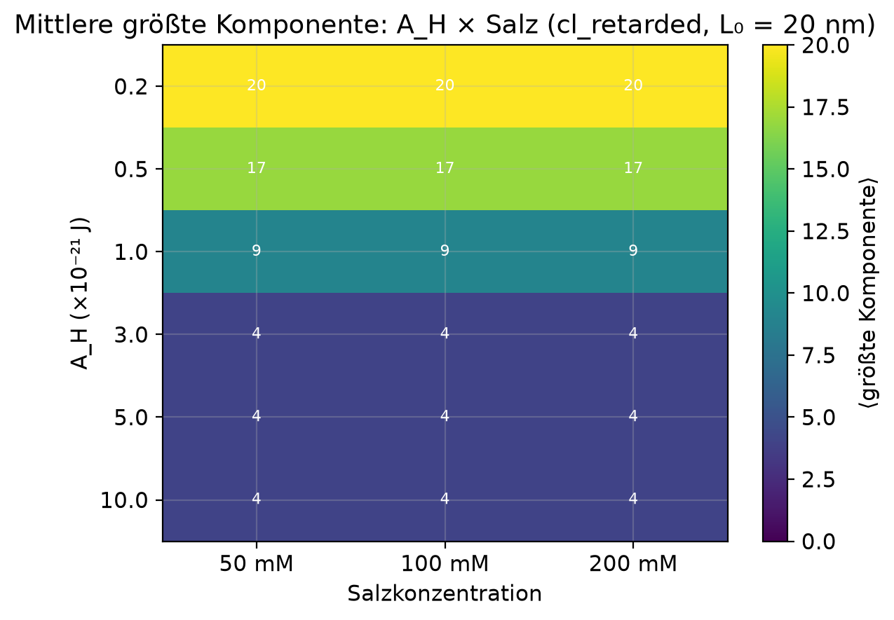

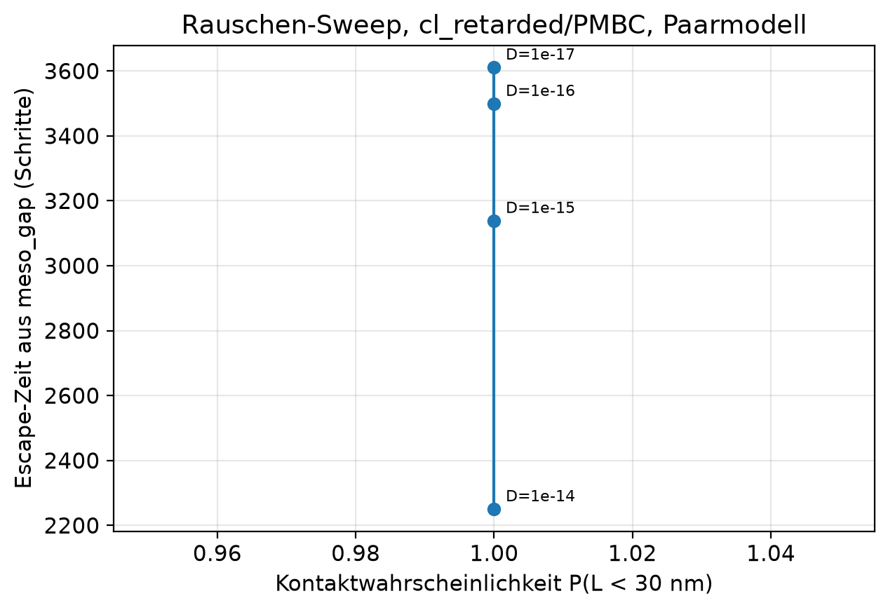

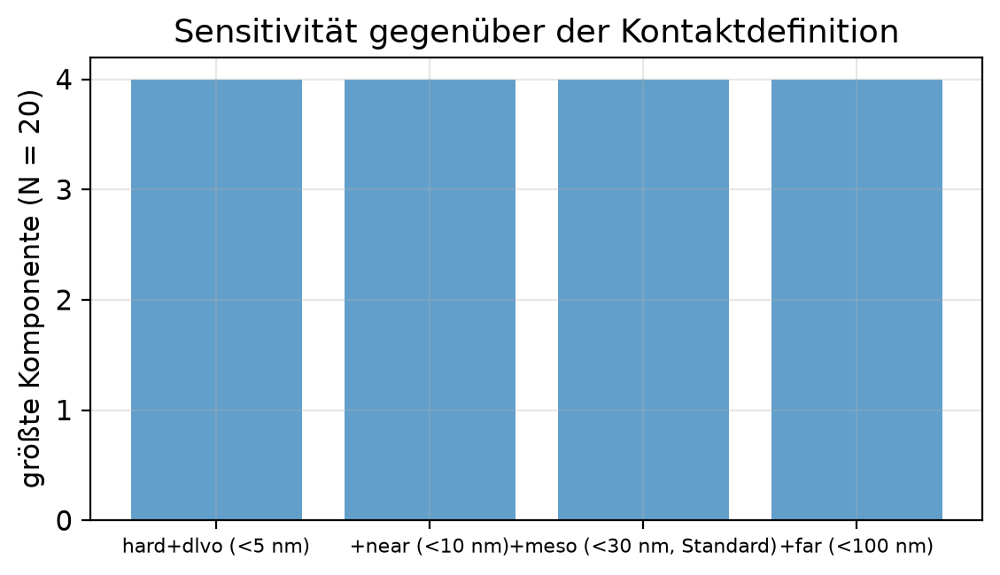

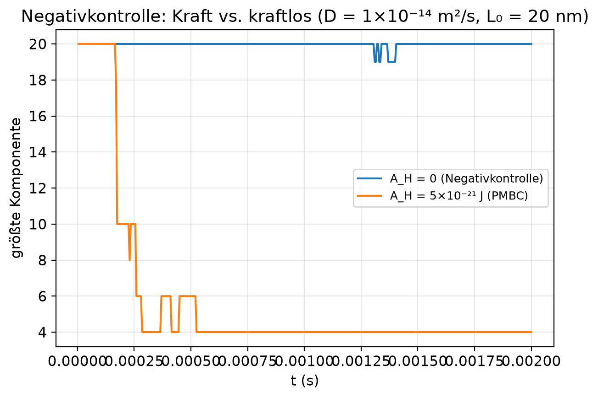

## 5. Interpretation (streng nach §10)

| Abstand | Ergebnis |
|---|---|
| 2–5 nm | Elektrostatik kann netto dominieren; Core wichtig; vdW/CL stark, aber nahbereichsempfindlich |
| 5–10 nm | Elektrostatik stark reduziert; PMBCs zeigen relevante Anziehung (U ~ einige kBT) |
| 10–30 nm | Elektrostatik praktisch weg; vdW/CL schwach bis moderat – PMBC plausibel, Fettsäure grenzwertig |
| 30–100 nm | Einzelpaar-Kräfte klein; Mehrkörper-/Geometrie-/Gap-Effekte nötig |

Standard-Lifshitz-/CL-Kopplung kann im Bereich 2–30 nm plausibel zur
Stabilisierung beitragen, besonders für PMBC-artige Protozellen. Für 30–100 nm
sind Einzelpaar-Kräfte wahrscheinlich schwach. **CL erklärt Clusterbildung von
2–100 nm nicht vollständig.**

## 6. Datenübergabe an Team 2

19 Runs, vorgeclusterter Start L₀ = 20 nm, Salz 100 mM, dt = 1×10⁻⁷ s:
{vdw, dlvo, cl_retarded} × {PMBC A_H = 5×10⁻²¹ J, Fettsäure
A_H = 0.5×10⁻²¹ J} × Seeds {0, 1, 42} mit N = 20, plus
cl_retarded/PMBC mit N = 50 als getrennter explorativer Lauf.
Schemata und Einheiten: siehe README (§17). `pairs.csv` nur Paare mit L < 100 nm;
Kontaktdefinition Standard L < 30 nm.

[hier eigene Prosa ergänzen: Absprachen mit Team 2, Validierung, Feedback]

## 7. Grenzen

- **Kraftbegrenzung:** nahe Kontakt dominiert der Core; die Begrenzung auf 20 pN
  kappt Extremereignisse und verlangsamt Kontaktbildung minimal – dokumentierter
  Preis für numerische Stabilität (§18 Fehler 6).
- **Didaktisches Modell:** r(L)-Retardierungsfaktor statt vollständiger
  Lifshitz-/Matsubara-Rechnung (§8 ist Ausblick).
- **Diffusionskoeffizient:** D = 1×10⁻¹⁶ m²/s ist didaktisch gewählt (Anhang);
  damit diffundieren verdünnte Suspensionen in machbarer Zeit nicht in den
  Kraftbereich – Clusterbildung aus der verdünnten Phase ist hier nicht
  beobachtbar, Persistenz vorgeformter Kontakte schon.
- **Korrektur Anhangscode:** die 2D-Paarsumme des Anhangs
  (`forces[i] += F*direction`) kehrt die §5-Vorzeichenkonvention um
  (Anziehung wirkt abstoßend). Korrigiert in `src/brownian_cluster.py`
  (`forces[i] -= F*direction`) und durch Tests abgesichert; Auswirkung ohne
  Korrektur: Abstände öffnen sich unter Anziehung (in den Übergabedaten sichtbar).
- **2D ohne Hydrodynamik**, keine Vieleilchen-Abschirmung, keine Membrandetails.

## 8. Literatur

- Israelachvili, *Intermolecular and Surface Forces*
- Casimir; Lifshitz (Originalarbeiten)
- Nunes et al., Spreng et al. (Casimir zwischen Kugeln in Elektrolyten)
- Schoger et al. (universelle Casimir-Interaktionen in Salzwasser)
- Seyedzahedi, Moradian (Elektrolyten, Schichtmedien, TE/TM)