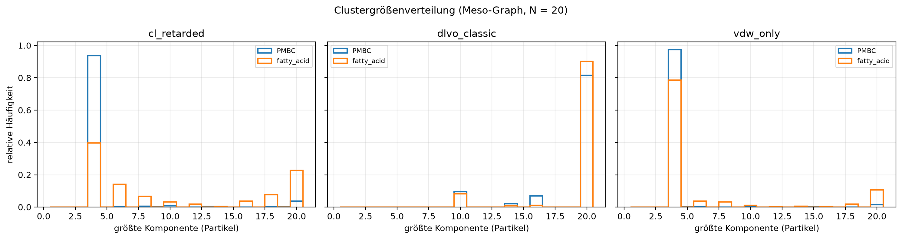
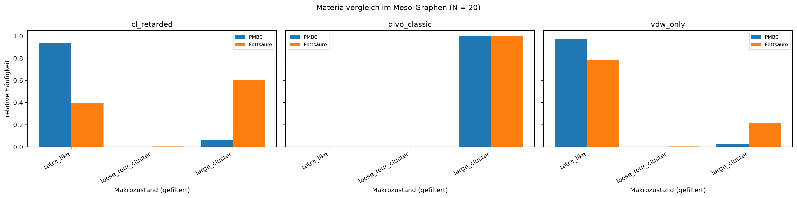
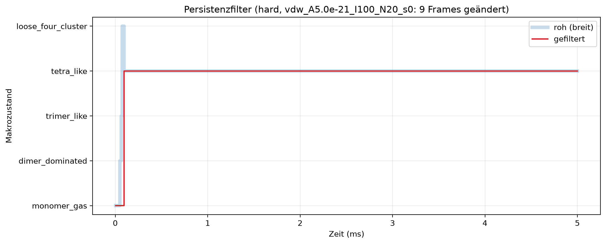
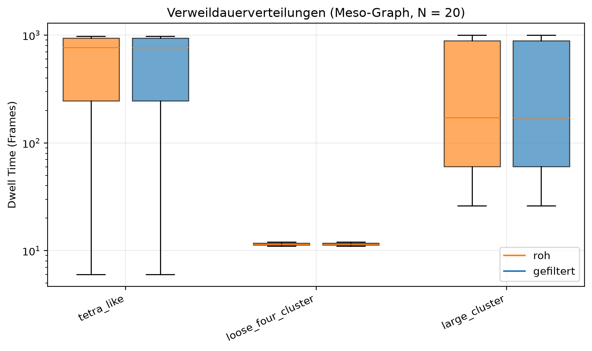
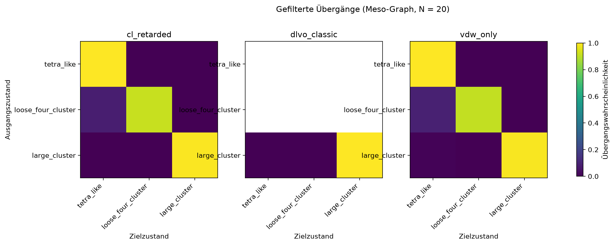
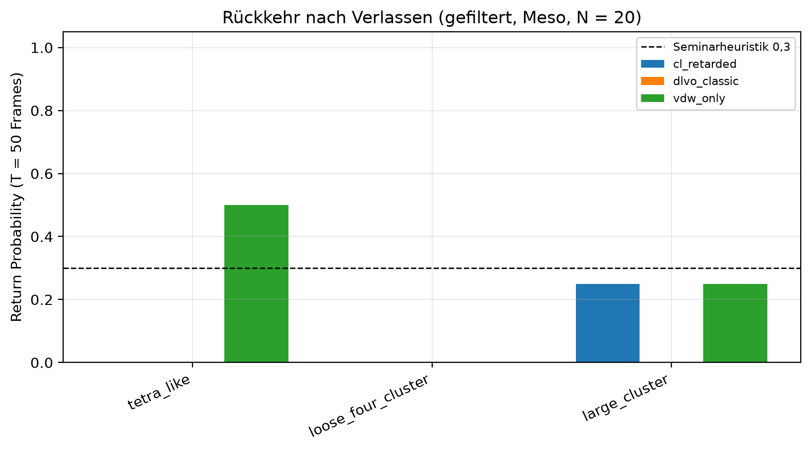
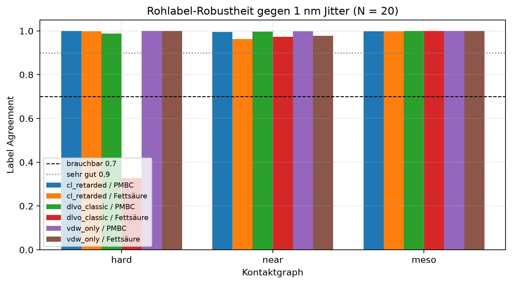

# Team 2 – Makrozustände und Attractor Memory: Bericht

> **Status:** finale Analyse auf dem erweiterten Team-1-Export: 18 vergleichbare
> N=20-Runs aus drei Modellen, zwei Materialien und drei Seeds, plus ein
> getrennter N=50-Explorationslauf. Alle Kern-CSVs, Notebooks und Abbildungen
> wurden aus diesem Export neu erzeugt.

## 1. Einleitung

Team 1 liefert Positionen, Paarabstände und Kontaktinformationen für
Protozellen mit R = 500 nm. Team 2 beantwortet die Leitfrage, ob daraus stabile
Makrozustände wie Monomer-Gas, Dimer, Trimer, tetraederähnliche Cluster oder
größere Aggregate folgen und ob diese Zustände Rückkehrdynamik zeigen. Ein
Makrozustand wird hier nicht als oberflächliches Label verstanden, sondern als
Klasse von Mikrokonfigurationen, die reproduzierbar, persistenzgefiltert,
jitter-robust und dynamisch anschlussfähig für Team 3 und 4 ist.

## 2. Daten und Einheiten

Die Quelle ist `team1_forces/data/processed`. Positionen sind Meter, Zeiten
Sekunden, Radien Nanometer, Hamaker-Konstanten Joule. Der Team-2-Algorithmus
nutzt immer den Oberflächenabstand

\[
L_{ij} = \|x_j-x_i\|_{\mathrm{mic}} - 2R,\qquad R=500\ \mathrm{nm},
\]

mit Minimum Image in einer festen 20-µm-Box. Der Mittelpunktabstand wird nie
als Kontaktabstand verwendet.

Die Team-1-Übergabe enthält 19 Runs mit je 1000 Frames:

- N = 20, {`vdw`, `dlvo`, `cl_retarded`} × {PMBC A_H = 5×10⁻²¹ J,
  Fettsäure A_H = 0.5×10⁻²¹ J} × Seeds {0, 1, 42} = **18 Vergleichsläufe**;
- N = 50, `cl_retarded`/PMBC, Seed 42 = **1 getrennter Explorationslauf**.

`vdw` wird in der Team-2-/Team-3-Schnittstelle als `vdw_only` und `dlvo` als
`dlvo_classic` benannt. Der N=50-Lauf bleibt außerhalb des N=20-Modell-/Materialvergleichs.

## 3. Methode

### 3.1 Abstandszonen

Die Grenzen aus dem Aufgabenblatt sind unverändert: `hard_contact` L < 2 nm,
`dlvo_zone` 2–5 nm, `near_gap` 5–10 nm, `meso_gap` 10–30 nm,
`far_gap` 30–100 nm und `separated` L ≥ 100 nm. `far_gap` ist explorative Nähe,
keine harte Bindung. Negative L bleiben als Überlappungsdiagnose sichtbar.

### 3.2 Kontaktgraphen, Features und Makrozustände

Pro Frame wird eine Paartabelle einmal berechnet und daraus `G_hard`,
`G_near` und `G_meso` gebaut; isolierte Knoten bleiben erhalten. Für jede Frame
entstehen `largest_cluster`, `n_edges`, `n_components`, `mean_degree` und die
Clustergrößenverteilung. Der Makrozustandskatalog bleibt klein:

`monomer_gas`, `dimer_dominated`, `trimer_like`, `tetra_like`,
`loose_four_cluster`, `large_cluster`, `mixed_transition`.

`tetra_like` ist im 2D-Setting ein Kompaktheits-Proxy für eine Viererkomponente
mit mindestens vier Kanten. Es ist keine Aussage über eine echte 3D-Tetraedergeometrie.

### 3.3 Persistenzfilter, Dwell Times und Rückkehr

Runs unter fünf Frames werden gefiltert, ohne die Rohsequenz zu löschen. Das
wichtigste Ergebnis dieser Methode ist die Trennung von `macrostate_raw` und
`macrostate_filtered`. Dwell Times werden als zusammenhängende Runs und mit
Zensierindikatoren gespeichert. Return Probability nutzt T = 50 Frames, Mean
Return Time T = 200 Frames. Ein Abgang zählt nur dann in die Returnstatistik,
wenn der zukünftige Horizont vollständig beobachtet wurde.

### 3.4 Robustheit und Kandidatenheuristik

Für jede Frame und jeden Graphen werden Rohlabels nach reproduzierbarem
1-nm-Jitter erneut berechnet. Der Seed kommt ohne randomisiertes `hash()` aus
Run-ID, Zeit und Graphdefinition. Der Kandidatenkatalog kombiniert:

- relative Häufigkeit > 5 %,
- mittlere Dwell Time > 5 Frames,
- Return Probability > 0.3 innerhalb T = 50,
- Zustand in mindestens drei Seeds,
- Label Agreement > 0.7.

Erfüllt der Kandidat alle fünf Kriterien, ist er ein **heuristischer
Attraktor-Kandidat**, kein formal bewiesener Attraktor.

## 4. Ergebnisse

### 4.1 Zustandsverteilung und Modellvergleich

Im gefilterten Meso-Graphen geben die N=20-Sequenzen folgendes Bild:

| Modell | Material | Dominanter Zustand | Relative Häufigkeit | Mittlere Dwell Time |
|---|---|---|---:|---:|
| `cl_retarded` | PMBC | `tetra_like` | 0.9367 | 936.7 Frames |
| `cl_retarded` | PMBC | `large_cluster` | 0.0633 | 63.3 Frames |
| `cl_retarded` | fatty_acid | `large_cluster` | 0.6027 | 361.6 Frames |
| `cl_retarded` | fatty_acid | `tetra_like` | 0.3933 | 271.5 Frames |
| `dlvo_classic` | PMBC | `large_cluster` | 1.0000 | 1000.0 Frames |
| `dlvo_classic` | fatty_acid | `large_cluster` | 1.0000 | 1000.0 Frames |
| `vdw_only` | PMBC | `tetra_like` | 0.9730 | 973.0 Frames |
| `vdw_only` | fatty_acid | `tetra_like` | 0.7813 | 468.8 Frames |
| `vdw_only` | fatty_acid | `large_cluster` | 0.2150 | 129.0 Frames |

Die Dominanz großer Komponenten ist dadurch erklärbar, dass die Startbedingung
vorgeclustert ist. Nicht die Entstehung der Cluster wird geprüft, sondern ihre
Persistenz, ihre Rückkehr nach Störung und die Stabilität ihrer Labels.





`cl_retarded` und `vdw_only` führen bei Fettsäure zu einem Wechselspiel zwischen
`tetra_like` und großen Clustern; bei PMBC dominiert jeweils der kompakte
Viererzustand. `dlvo_classic` erzeugt unter dieser Kontaktdefinition in beiden
Materialien beständig eine große Komponente.

**Quantitative Grenze: Tiefenüberlappung.** In `vdw_only` und `cl_retarded`
gibt es keinen Core-Repulsionsterm, sondern nur Attraktion und Brown-Dynamik.
Nach Kontakt können Protozellen daher fast koindizident werden; Team 2 folgt
beim Labeln wörtlich der Regel L < 2 nm, aber die Interpretation darf nicht
als Kontaktkluster überinterpretiert werden. In den nicht-getrennten
Paarzeilen der N=20-Runs liegt der Anteil mit starker Tiefenüberlappung
(L < −900 nm) bei:

| Modell | Material | Anteil L < −900 nm |
|---|---|---:|
| `vdw_only` | PMBC | 91.8 % |
| `vdw_only` | fatty_acid | 72.1 % |
| `cl_retarded` | PMBC | 85.8 % |
| `cl_retarded` | fatty_acid | 33.8 % |
| `dlvo_classic` | PMBC/fatty_acid | 0.0 % |

Die `dlvo_classic`-Modellvariante enthält den Core-Term und zeigt diesen
Koindizidenz-Artefakt nicht. Alle vdw-/CL-basierten Kandidaten unten sind
deshalb unter dieser Tiefenüberlappungsgrenze zu lesen.

### 4.2 Dwell Times, Rückkehren und Persistenzfilter

Der Repräsentativfall in Abbildung 1 wird deterministisch aus der größten Anzahl
Frames mit `macrostate_raw != macrostate_filtered` gewählt. Das ist
`vdw_A5.0e-21_I100_N20_s0` im Hard-Graphen mit neun geänderten Frames. Der
Persistenzfilter ist im finalen Export insgesamt ein Grenzfall: Nur 57 von
57,000 Zustandszeilen (0.1 %) ändern sich, und im Meso-Graphen keine einzige.
Damit lautet das methodische Ergebnis nicht „der Filter kürzt häufig“,
sondern: unter den vorliegenden, vorwiegend persistenten Läufen ist
`min_dwell=5` bereits ausreichend; Roh- und Filtersequenz sind daher fast
identisch.



Die Dwell-Time-Verteilungen zeigen zwei Klassen: dominante Clusterzustände mit
langen Aufenthalten und kurze Übergangslabels wie `loose_four_cluster`.



Die Übergangsmatrizen sind im Meso-Graphen stark diagonal:



Es gibt vier **heuristische Attraktor-Kandidaten** mit drei Seeds:

| Modell | Material | Graph | Zustand | Häufigkeit | Dwell Time | Return Probability |
|---|---|---|---|---:|---:|---:|
| `cl_retarded` | fatty_acid | meso | `large_cluster` | 0.6027 | 361.6 | 0.40 |
| `vdw_only` | fatty_acid | meso | `tetra_like` | 0.7813 | 468.8 | 0.50 |
| `vdw_only` | fatty_acid | meso | `large_cluster` | 0.2150 | 129.0 | 0.40 |
| `vdw_only` | fatty_acid | near | `dimer_dominated` | 0.0983 | 49.2 | 0.50 |

Alle vier erfüllen die fünf Seminarheuristiken, also auch die
Seed-Reproduzierbarkeit und Label Robustheit. Trotzdem ist die Aussage
vorsichtig zu formulieren: es handelt sich um **Attraktor-Kandidaten**, nicht um
formal bewiesene Attraktoren oder um einen Beweis von Attractor Memory. Wichtig
ist zusätzlich, dass die `vdw_only`-/`cl_retarded`-Kandidaten mit den oben
quantifizierten Tiefenüberlappungen zusammenhängen; sie beschreiben deshalb
Rückkehr in eine Makroklasse unter diesem Modellartefakt und sind damit nicht
als Beweis für nicht überlappende Kompaktcluster zu lesen.


`dlvo_classic` produziert extrem stabile `large_cluster`-Labels, aber Return
Probability/mean return time sind ohne Verlassen des Zustands nicht verfügbar;
deshalb ist dort kein Kandidatenstatus angezeigt. `cl_retarded`/PMBC und
`vdw_only`/PMBC haben sehr langlebige `tetra_like`-Zustände, aber ebenfalls nur
wenige bzw. keine beobachtbaren Abgänge innerhalb des 5-ms-Fensters.

### 4.3 Jitter-Robustheit

Die Meso-Labels sind gegen 1-nm-Jitter sehr robust:

| Modell | Material | `near` | `meso` |
|---|---|---:|---:|
| `cl_retarded` | PMBC | 0.9953 | 0.9987 |
| `cl_retarded` | fatty_acid | 0.9633 | 0.9977 |
| `dlvo_classic` | PMBC | 0.9967 | 1.0000 |
| `dlvo_classic` | fatty_acid | 0.9727 | 1.0000 |
| `vdw_only` | PMBC | 0.9983 | 0.9997 |
| `vdw_only` | fatty_acid | 0.9780 | 0.9993 |

Der Hard-Graph ist empfindlicher. Der extreme Fall ist
`dlvo_classic`/fatty_acid mit Label Agreement 0.328, weil viele Paare nahe der
2-nm-Grenze liegen. Das ist ein Zonendefinitionseffekt, kein Beweis dafür,
dass die Physik instabil ist. Deshalb ist `G_meso` die Standardübergabe.



## 5. Übergabe an Team 3

`data/processed/team3_macrostates.csv` enthält 19,000 Meso-Graph-Sequenzen aus
allen 19 Läufen. Die Spalten sind exakt:

`run_id, seed, time, macrostate_raw, macrostate_filtered, model_type,
material_type, A_H, salt_mM, noise, largest_cluster, mean_degree`.

Team 3 erhält damit `vdw_only`, `dlvo_classic` und `cl_retarded` für
`fatty_acid` und `PMBC`. Die gefilterte Sequenz ist Hauptsignal; die Rohsequenz
bleibt für Filterdiagnosen und Sensitivitätsprüfung erhalten.

## 6. Methodische Reflexion

**Robust und belastbar** sind die festen Zonengrenzen, die getrennten Graphen,
die Roh-/Filtered-Sequenzführung, die vollständigen Horizonte in den
Returnstatistiken und die reproduzierbaren Jitter-Seeds.

**Wichtige Grenzen:**

- Cluster entstehen bereits in der Startbedingung. Die Analyse messet
  Persistenz und Rückkehr, keine spontane Clusterbildung.
- `tetra_like` ist ein 2D-Kompaktheits-Proxy.
- `vdw_only` und `cl_retarded` haben keinen Core-Repulsionsterm; nach Kontakt
  können Protozellen tief überlappen. Die Tabelle oben quantifiziert diesen
  Artefakt je Modell/Material.
- Heuristische Kandidaten sind keine formalen Attraktoren.
- Returnstatistiken sind an finiten Fenstern und an der Sequenzgrenze zensiert.
- `dlvo_classic` verlässt den dominanten Zustand im beobachtbaren Fenster kaum;
  deshalb ergeben sich keine Returnprozentalwerte.
- Drei Seeds sind der geforderte Mindeststandard, keine ausgedehnte Statistik.
- Es wird absichtlich kein `cl_meso_hypothesis` implementiert, weil weder
  Aufgabenblatt noch Team-1-Daten eine Formel oder Parameterkontrakt liefern.
- Das aktuelle Zeitfenster ist 5 ms; Attractor Memory über längere Zeiträume
  wäre eine eigene Störungsrückkehr-Analyse.

## 7. Reproduktion

Siehe `README.md`. Kernauftrag:

```bash
../team1_forces/.venv/bin/python -m pytest -q
../team1_forces/.venv/bin/jupyter nbconvert --to notebook --execute --inplace \
    --ExecutePreprocessor.timeout=3600 notebooks/01_zones_graphs.ipynb
../team1_forces/.venv/bin/jupyter nbconvert --to notebook --execute --inplace \
    --ExecutePreprocessor.timeout=3600 notebooks/02_sequences_attractors.ipynb
../team1_forces/.venv/bin/jupyter nbconvert --to notebook --execute --inplace \
    --ExecutePreprocessor.timeout=3600 notebooks/03_robustness_comparison.ipynb
```

Die Ausführung der drei Team-2-Notebooks dauerte nach der finalen
Reviewkorrektur 4:19.6 wall clock (1:44.3 + 0:20.5 + 2:13.9).
